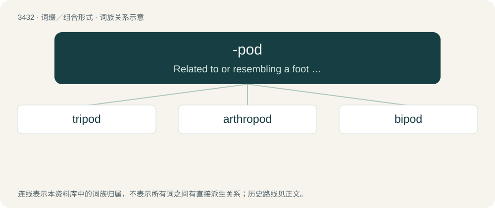

# 3513 · -pod — Related to or resembling a foot or similar limb.

[总目录](../00_总目录_按常用程度.md)

**类型**：词缀／组合形式　｜　**来源语言**：见词源记录

## 核心含义与来源

- 核心含义：Related to or resembling a foot or similar limb.
- 英文含义：Related to or resembling a foot or similar limb.
- 词形：-pod

**来源记录 1**（后缀／后置成分；Related to or resembling a foot or similar limb.）

From Ancient Greek ποδός (podós), genitive singular of πούς (poús, “foot, leg”).

## 词族图

## 单词速览（常用到不常用）

| 单词 | 音标 | 释义 |
|---|---|---|
| [tripod](#w-1) | 英 /ˈtɹaɪpɒd/；美 /ˈtɹaɪpɑd/ | n. 三脚桌, 三脚架；\[医\] 三脚架, 三脚台 |
| [arthropod](#w-2) | /ˈɑːθɹəpɒd/ | n. 节肢动物；\[医\] 节肢动物 |
| [bipod](#w-3) | /ˈbaɪpɒd/ | n. 两脚架 |

## 逐词详解

### 1. tripod

**词性**：名词　｜　**音标**：英 /ˈtɹaɪpɒd/；美 /ˈtɹaɪpɑd/

**中文释义**：n. 三脚桌, 三脚架；\[医\] 三脚架, 三脚台

**英文义项**：A three-legged stand or mount. / An organism with three limbs.

**构词拆分**：tri- + -pod

**词源与演化**：

Borrowed from Latin tripod- (stem of tripūs, tripodis), from Ancient Greek τρίποδ- (trípod-, stem of τρίπους, τρίποδος (trípous, trípodos), literally “three-footed”); equivalent to tri- + -pod. Doublet of tripus, tripos, and teapoy.

**例句**：

> Cameras often have tripod attachments, which help when taking steady photographs.

该用例对应义项：A three-legged stand or mount.

### 2. arthropod

**词性**：名词　｜　**音标**：/ˈɑːθɹəpɒd/

**中文释义**：n. 节肢动物；\[医\] 节肢动物

**英文义项**：An invertebrate animal of the phylum Arthropoda, characterized by a chitinous exoskeleton and multiple jointed appendages.

**构词拆分**：arthro- + -pod

**词源与演化**：

From New Latin Arthropoda, from Ancient Greek ἄρθρον (árthron, “joint”) + πούς (poús, “foot”), equivalent to arthro- + -pod.

**例句**：

> This little arthropod is more poisonous than you can imagine.

### 3. bipod

**词性**：名词　｜　**音标**：/ˈbaɪpɒd/

**中文释义**：n. 两脚架

**英文义项**：A two-legged stand or organism.

**构词拆分**：bi- + -pod

**词源与演化**：

From bi- + -pod.

**例句**：

> Ziri extended his bipod and aimed at the hyena.
