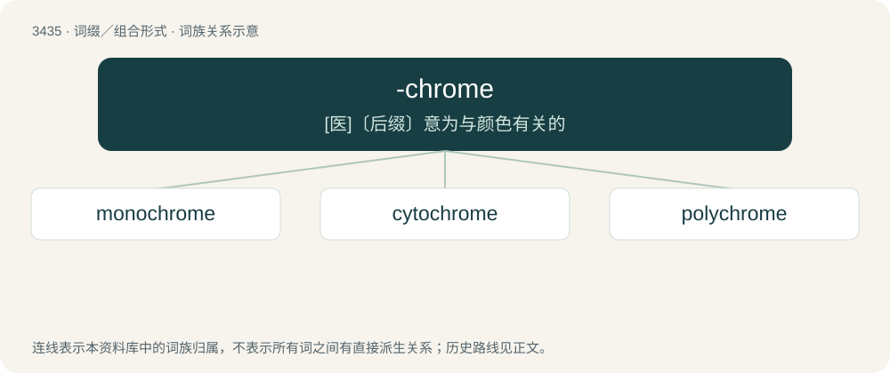

# 3516 · -chrome — \[医\]〔后缀〕意为与颜色有关的

[总目录](../00_总目录_按常用程度.md)

**类型**：词缀／组合形式　｜　**来源语言**：见词源记录

## 核心含义与来源

- 核心含义：\[医\]〔后缀〕意为与颜色有关的
- 英文含义：having a specified colour
- 词形：-chrome

## 词族图

## 单词速览（常用到不常用）

| 单词 | 音标 | 释义 |
|---|---|---|
| [monochrome](#w-1) | 英 /ˈmɒn.əˌkɹəʊm/；美 /ˈmɑn.əˌkɹoʊm/ | n. 单色画, 单色, 黑白；a. 单色的, 黑白的；\[计\] 单色 |
| [cytochrome](#w-2) | /ˈsaɪtəkɹəʊm/ | n. 细胞色素；\[化\] 细胞色素 |
| [polychrome](#w-3) | /ˈpɒlikrəum/ | a. 多彩的, 彩绘的；n. 彩色物品, 多色彩 |

## 逐词详解

### 1. monochrome

**词性**：名词　｜　**音标**：英 /ˈmɒn.əˌkɹəʊm/；美 /ˈmɑn.əˌkɹoʊm/

**中文释义**：n. 单色画, 单色, 黑白；a. 单色的, 黑白的；\[计\] 单色

**英文义项**：A black and white image, especially such a photograph. / A painting executed in shades of a single colour.

**构词拆分**：mono- + -chrome

**词源与演化**：

From Ancient Greek μονόχρωμος (monókhrōmos), from μόνος (mónos, “one”) + χρῶμα (khrôma, “color”); mono- + -chrome.

**例句**：

> In comparison to a colour print, a monochrome print is less expensive.

### 2. cytochrome

**词性**：名词　｜　**音标**：/ˈsaɪtəkɹəʊm/

**中文释义**：n. 细胞色素；\[化\] 细胞色素

**英文义项**：Any of various related hemoproteins found in the cells of most organisms, which are an important part of cell respiration.

**构词拆分**：cyto- + -chrome

**词源与演化**：

From cyto- + -chrome.

### 3. polychrome

**词性**：形容词　｜　**音标**：/ˈpɒlikrəum/

**中文释义**：a. 多彩的, 彩绘的；n. 彩色物品, 多色彩

**英文义项**：Using multiple or many colours. / Executed in the manner of polychromy.

**构词拆分**：poly- + -chrome

**词源与演化**：

From poly- + -chrome.

**用法示例／搭配（非完整句）**：

> polychrome printing

该用例对应义项：Executed in the manner of polychromy.
