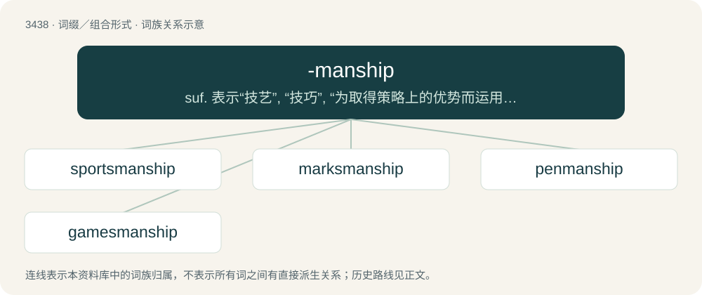

# 3517 · -manship — suf. 表示“技艺”, “技巧”, “为取得策略上的优势而运用某种手段的做法或艺术”：grantsmanship

[总目录](../00_总目录_按常用程度.md)

**类型**：词缀／组合形式　｜　**来源语言**：见词源记录

## 核心含义与来源

- 核心含义：suf. 表示“技艺”, “技巧”, “为取得策略上的优势而运用某种手段的做法或艺术”：grantsmanship
- 英文含义：Expertise, involvement, or special status in an area.
- 词形：-manship

**来源记录 1**（后缀／后置成分；Expertise, involvement, or special status in an area.）

From -man + -ship.

## 词族图

## 单词速览（常用到不常用）

| 单词 | 音标 | 释义 |
|---|---|---|
| [sportsmanship](#w-1) | /ˈspɒːtsmənʃip/ | n. 运动员精神 |
| [marksmanship](#w-2) | 美 /ˈmɑɹksmənʃɪp/ | n. 射击术, 枪法 |
| [penmanship](#w-3) | /ˈpenmənʃip/ | n. 书法, 笔法, 笔迹, 文体 |
| [gamesmanship](#w-4) | /ˈgeimzmənʃip/ | n. 搅乱战术 |

## 逐词详解

### 1. sportsmanship

**词性**：名词　｜　**音标**：/ˈspɒːtsmənʃip/

**中文释义**：n. 运动员精神

**英文义项**：The good attitude/behaviour displayed by players of a game; fairness, determination, magnanimity, courtesy towards opponents, and winning or losing gracefully. / The behaviour exhibited in playing sports, either good or bad.

**构词拆分**：From sports + -manship.

**词源与演化**：

From sports + -manship.

**例句**：

> James showed good sportsmanship in consoling Shankar after his wicket fell.

该用例对应义项：The behaviour exhibited in playing sports, either good or bad.

### 2. marksmanship

**词性**：名词　｜　**音标**：美 /ˈmɑɹksmənʃɪp/

**中文释义**：n. 射击术, 枪法

**英文义项**：The ability to shoot accurately at a target.

**构词拆分**：marksman + -ship；marks + -manship

**词源与演化**：

From marksman + -ship or marks + -manship.

### 3. penmanship

**词性**：名词　｜　**音标**：/ˈpenmənʃip/

**中文释义**：n. 书法, 笔法, 笔迹, 文体

**英文义项**：Synonym of handwriting or chirography, one's own style of writing. / Synonym of calligraphy, the art of beautiful writing.

**构词拆分**：pen + -manship

**词源与演化**：

From pen + -manship.

**例句**：

> A student's penmanship used to be graded, but the digital age has done away with that.

### 4. gamesmanship

**词性**：名词　｜　**音标**：/ˈgeimzmənʃip/

**中文释义**：n. 搅乱战术

**英文义项**：The use of legal but unsporting tactics to gain an advantage over one’s opponent.

**构词拆分**：game + -s- + -manship；gamesman + -ship

**词源与演化**：

From game + -s- + -manship or gamesman + -ship.

**例句**：

> They kept the other team waiting on the field until the last possible moment – that was a clear case of gamesmanship.

该用例对应义项：The use of legal but unsporting tactics to gain an advantage over one’s opponent.
