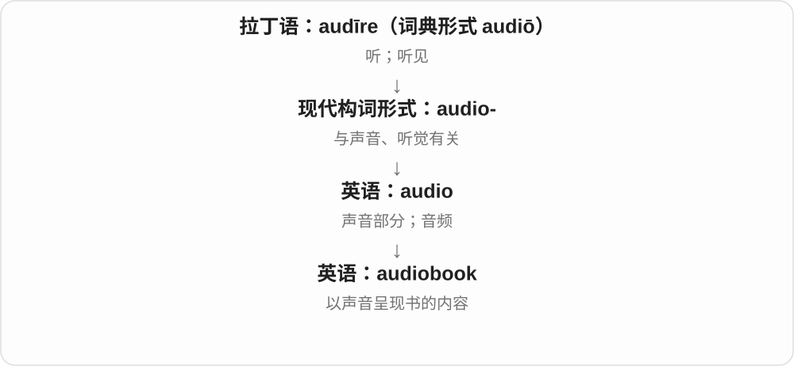
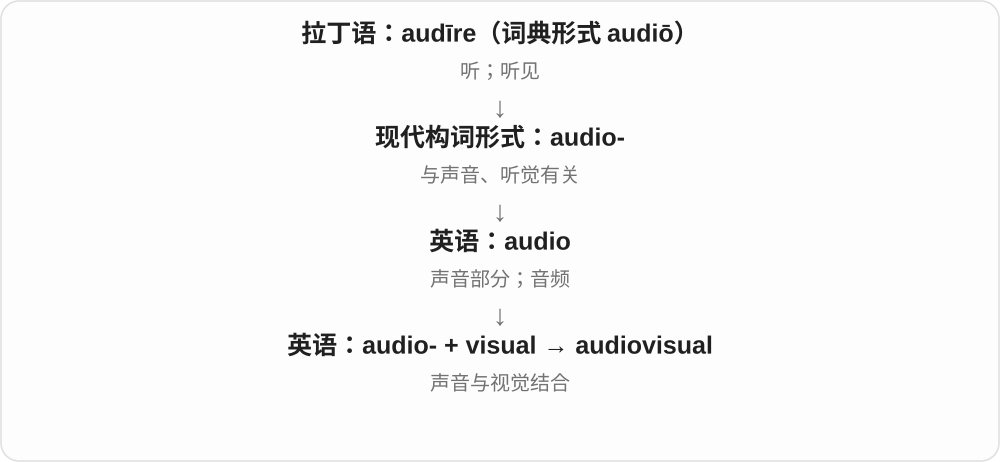
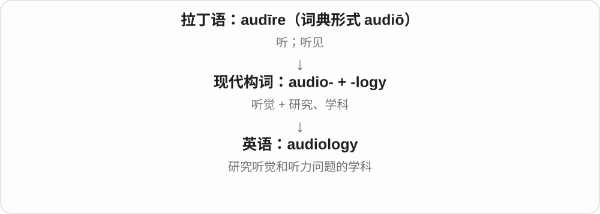

# 3518 · audio- — 听觉、声音

[逐词精讲目录](../00_逐词精讲目录.md) · [总目录](../00_总目录_按常用程度.md)

## 核心词根与来源

以拉丁 audire 听、audio 我听等词族的 audi- 加连接形式形成，进入近代媒体、设备和学科名称。

**AUDIO-：把内容、设备或研究与听觉声音相连**

audiobook 把书变成可听的内容；audiovisual 把声音和画面放在一起；audiology 则研究听觉相关问题。

- **声音内容及视听结合**：audiobook · audiovisual
- **爱好者、学科**：audiophile · audiology

## 词形与演化规律

audio- + book → audiobook；audio- + visual → audiovisual；audio- + -phile → audiophile；audio- + -logy → audiology。

## 单词速览（按词族由简到繁）

同一基础词的相关扩展放在一起，先读基础形式，再读扩展；各组之间优先读常用的。具体词源关系见各词讲解。

| 单词 | 音标 | 核心意思 |
|---|---|---|
| [audiobook](#w-1) | 英 /ˈɔːdiəʊbʊk/；美 /ˈɑːdioʊbʊk/ | 有声书 |
| [audiovisual](#w-2) | 英 /ˌɔːdiəʊˈvɪʒuəl/；美 /ˌɑːdioʊˈvɪʒuəl/ | 视听的；同时涉及声音与画面的 |
| [audiophile](#w-3) | 英 /ˈɔːdiəʊfaɪl/；美 /ˈɔːdioʊfaɪl/ | 音响发烧友；重视音质的爱好者 |
| [audiology](#w-4) | 英 /ˌɔːdiˈɒlədʒi/；美 /ˌɑːdiˈɑːlədʒi/ | 听力学 |

## 逐词讲解

### 1. audiobook — 有声书

**音标**：英 /ˈɔːdiəʊbʊk/；美 /ˈɑːdioʊbʊk/

**先抓住这个画面**

audiobook 就是把书的内容变成可以听的版本，眼睛不用盯着页面，也能跟着故事走。

**怎么拆**

audio-（声音）+ book（书），是现代英语组合词，不是古代拉丁语已经有了有声书。

**怎么变成今天的意思**

book 提供内容形式，audio 说明接收方式。朗读可以完整，也可以是删节版，是否完整还要看版本说明。

**常见搭配与例句**

listen to an audiobook；an audiobook narrator；an unabridged audiobook（完整版有声书）。

> I listened to an audiobook on the train.

我在火车上听了一本有声书。

> The author narrated the audiobook herself.

这本有声书由作者亲自朗读。

**别混淆**

audiobook 通常对应书籍；podcast 是按节目或系列发布的音频，内容不一定来自一本书。

### 2. audiovisual — 视听的；同时涉及声音与画面的

**音标**：英 /ˌɔːdiəʊˈvɪʒuəl/；美 /ˌɑːdioʊˈvɪʒuəl/

**先抓住这个画面**

audiovisual 把耳朵和眼睛一起用上：有声音，也有图像，比如带讲解的演示视频。

**怎么拆**

audio-（听、声音）+ visual（视觉的）。两个成分分别点明接收信息的通道。

**怎么变成今天的意思**

它可形容内容，也可形容录制、播放这类内容的设备。不能因为词里有两个感官，就理解成所有感官都参与。

**常见搭配与例句**

audiovisual equipment；audiovisual materials；an audiovisual presentation；audiovisual aids。

> The classroom has modern audiovisual equipment.

这间教室配有现代视听设备。

> The museum uses audiovisual displays to explain the excavation.

博物馆用视听展示来介绍这次发掘。

**别混淆**

audio 只强调声音；visual 只强调视觉；audiovisual 把两者结合。multimedia 的范围还可以更广。

### 3. audiophile — 音响发烧友；重视音质的爱好者

**音标**：英 /ˈɔːdiəʊfaɪl/；美 /ˈɔːdioʊfaɪl/

**先抓住这个画面**

不只在意播的是什么歌，还会仔细听设备怎样还原声音。

**怎么拆**

现代 audio- 声音 + -phile 爱好者，前半接拉丁听觉词族，后半来自希腊；是混合古典成分的新词。

**怎么变成今天的意思**

**古希腊语 philos / philein**  
亲爱的、喜爱；喜欢、亲近

↓

**希腊 -philos 一系 → 英语 -phile**  
爱好某事的人

↓

**现代 audio- + -phile → audiophile**  
对音响和声音还原特别有兴趣的人

audiophile equipment 常指面向重视音质的听众的设备。这个称呼不保证器材昂贵，更不证明对某种声音的判断一定正确。

**常见搭配与例句**

an enthusiastic audiophile；audiophile equipment；an audiophile collection。

> As an audiophile, she enjoys comparing speakers in the same room.

作为音响爱好者，她喜欢在同一个房间里比较不同音箱。

> The shop offers listening sessions for audiophiles.

这家店为音响爱好者提供试听活动。

**别混淆**

music lover 只说爱音乐；audiophile 通常特别在意声音还原和播放设备。

### 4. audiology — 听力学

**音标**：英 /ˌɔːdiˈɒlədʒi/；美 /ˌɑːdiˈɑːlədʒi/

**先抓住这个画面**

audiology 把“听得怎样”变成研究对象：声音怎样被感知，听力出现问题时怎样评估和帮助。

**怎么拆**

audio-（听觉）+ -logy（研究、学科），是现代科学利用古典成分组成的术语。

**怎么变成今天的意思**

它研究的是人的听觉及相关问题，不是研究歌曲是否好听，也不是一般的音响器材评论。

**常见搭配与例句**

an audiology department；audiology services；a degree in audiology；an audiology assessment。

> She chose audiology because she wanted to help people with hearing difficulties.

她选择学习听力学，因为她希望帮助听力有困难的人。

> The hospital expanded its audiology services.

这家医院扩大了听力学相关服务。

**别混淆**

audiology 关注听觉与听力；acoustics“声学”更广泛研究声音的产生、传播等性质。

## 这一组要分清什么

audio 关注声音，audience 观众、听众又属于相关历史词族；audiophile 常说音响爱好者，不只是所有能听见声音的人。

## 串起来练习

The audiophile listened to an audiobook through the new speakers.

这位音响爱好者用新扬声器听了一本有声书。
