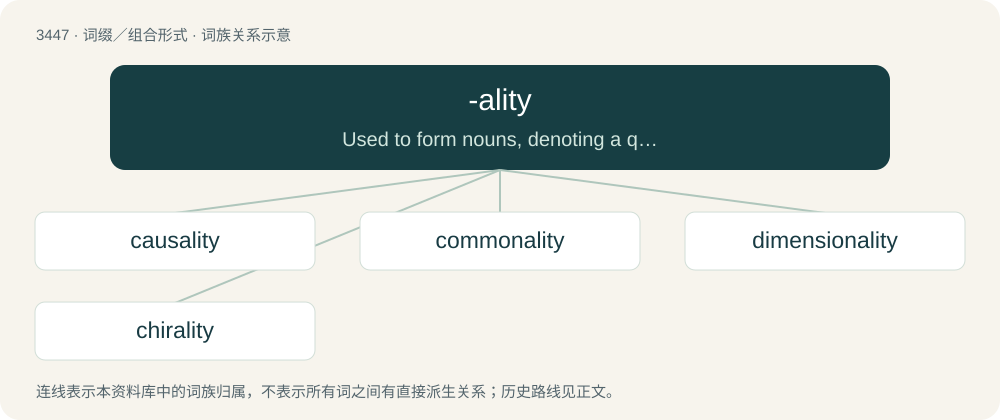

# 3526 · -ality — Used to form nouns, denoting a quality or condition, from adjectives ending in -al (which is not duplicated (see -ity)).

[总目录](../00_总目录_按常用程度.md)

**类型**：词缀／组合形式　｜　**来源语言**：见词源记录

## 核心含义与来源

- 核心含义：Used to form nouns, denoting a quality or condition, from adjectives ending in -al (which is not duplicated (see -ity)).
- 英文含义：Used to form nouns, denoting a quality or condition, from adjectives ending in -al (which is not duplicated (see -ity)).
- 词形：-ality

**来源记录 1**（后缀／后置成分；Used to form nouns, denoting a quality or condition, from adjectives ending in -al (which is not duplicated (see -ity)).）

From French -alité and Latin -ālitās. By surface analysis, -al + -ity.

## 词族图

## 单词速览（常用到不常用）

| 单词 | 音标 | 释义 |
|---|---|---|
| [causality](#w-1) | 英 /kɔːˈzæl.ɪ.tɪ/；美 /kɔˈzæl.ɪ.tɪ/ | n. 因果关系；\[化\] 因果性 |
| [commonality](#w-2) | 英 /ˌkɒm.əˈnæl.ɪ.ti/；美 /ˌkɑ.məˈnæl.ə.ti/ | n. 共同特性, 平民百姓 |
| [dimensionality](#w-3) | 英 /daɪˌmɛn.ʃəˈnæl.ɪ.tɪ/；美 /dɪˌmɛn.ʃəˈnæl.ə.tɪ/ | \[计\] 维数, 度数 |
| [chirality](#w-4) | /kaɪˈɹælɪti/ | \[医\] 偏光力 |

## 逐词详解

### 1. causality

**词性**：名词　｜　**音标**：英 /kɔːˈzæl.ɪ.tɪ/；美 /kɔˈzæl.ɪ.tɪ/

**中文释义**：n. 因果关系；\[化\] 因果性

**英文义项**：The agency of a cause; the action or power of a cause, in producing its effect. / The relationship between something that happens or exists and the thing that causes it; the cause and consequence relationship.

**构词拆分**：cause + -ality

**词源与演化**：

From Latin as if \*causalitas, from causalis (“causal”), from causa (“cause”). By surface analysis, causal + -ity = cause + -ality.

**例句**：

> What we speak of as 'causality' is nothing more than the phenomenon of repetition.

### 2. commonality

**词性**：名词　｜　**音标**：英 /ˌkɒm.əˈnæl.ɪ.ti/；美 /ˌkɑ.məˈnæl.ə.ti/

**中文释义**：n. 共同特性, 平民百姓

**英文义项**：The joint possession of a set of attributes or characteristics. / Such a shared attribute or characteristic

**构词拆分**：common + -ality

**词源与演化**：

From common + -ality.

### 3. dimensionality

**词性**：名词　｜　**音标**：英 /daɪˌmɛn.ʃəˈnæl.ɪ.tɪ/；美 /dɪˌmɛn.ʃəˈnæl.ə.tɪ/

**中文释义**：\[计\] 维数, 度数

**英文义项**：The state or characteristic of possessing dimensions. / The number of dimensions something has.

**构词拆分**：dimension + -ality

**词源与演化**：

From dimension + -ality.

**例句**：

> All matter has dimensionality.

该用例对应义项：the spatial property of having dimensions

### 4. chirality

**词性**：名词　｜　**音标**：/kaɪˈɹælɪti/

**中文释义**：\[医\] 偏光力

**英文义项**：The phenomenon, in chemistry, physics and mathematics, in which objects are mirror images of each other, but are otherwise identical; handedness.

**构词拆分**：chiral + -ity；chir- + -ality

**词源与演化**：

From chiral + -ity = chir- + -ality.
