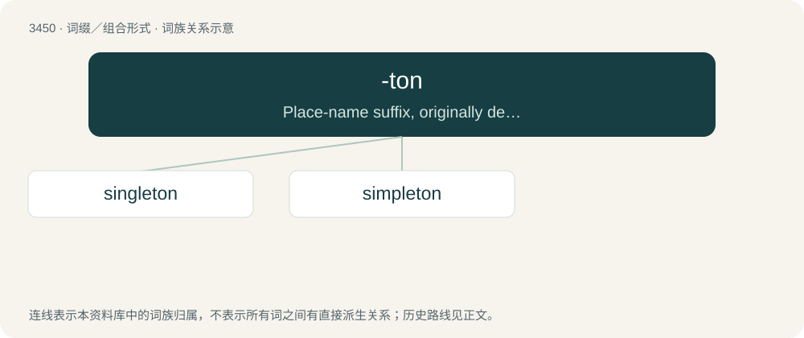

# 3531 · -ton — Place-name suffix, originally denoting a town or enclosure of buildings.

[总目录](../00_总目录_按常用程度.md)

**类型**：词缀／组合形式　｜　**来源语言**：见词源记录

## 核心含义与来源

- 核心含义：Place-name suffix, originally denoting a town or enclosure of buildings.
- 英文含义：Place-name suffix, originally denoting a town or enclosure of buildings.
- 词形：-ton

**来源记录 1**（后缀／后置成分；Place-name suffix, originally denoting a town or enclosure of buildings.）

From Middle English -ton, -tone, -tune, from Old English -tūn, derived from Old English tūn (“town”). Doublet of town.

## 词族图

## 单词速览（常用到不常用）

| 单词 | 音标 | 释义 |
|---|---|---|
| [singleton](#w-1) | 英 /ˈsɪŋ.ɡ(ə)l.tən/ | n. 一个, 独生子, 独身 |
| [simpleton](#w-2) | /ˈsɪmpəltən/ | n. 笨蛋, 傻子 |

## 逐词详解

### 1. singleton

**词性**：名词　｜　**音标**：英 /ˈsɪŋ.ɡ(ə)l.tən/

**中文释义**：n. 一个, 独生子, 独身

**英文义项**：A playing card that is the only one of its suit in a hand, especially at bridge. / A hand containing only one card of a certain suit.

**构词拆分**：single + -ton

**词源与演化**：

From single + -ton, probably following the model of simpleton.

**用法示例／搭配（非完整句）**：

> singleton preterm birth

该用例对应义项：A child or animal that is born singly, not as a twin or other multiple birth.

### 2. simpleton

**词性**：名词　｜　**音标**：/ˈsɪmpəltən/

**中文释义**：n. 笨蛋, 傻子

**英文义项**：A simple-minded person lacking common sense.

**构词拆分**：simple + -ton

**词源与演化**：

From simple + -ton (as in a surname). Compare French simplet, Italian semplicione.

**例句**：

> This one is a real simpleton, for sure. And he's a president.
