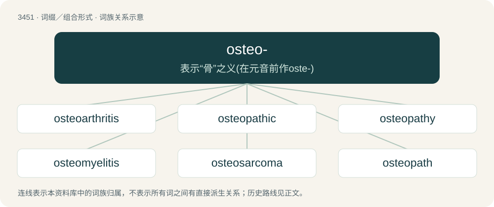

# 3532 · osteo- — 表示“骨”之义(在元音前作oste-)

[总目录](../00_总目录_按常用程度.md)

**类型**：词缀／组合形式　｜　**来源语言**：见词源记录

## 核心含义与来源

- 核心含义：表示“骨”之义(在元音前作oste-)
- 英文含义：bone
- 词形：osteo-

## 词族图

## 单词速览（常用到不常用）

| 单词 | 音标 | 释义 |
|---|---|---|
| [osteoarthritis](#w-1) | /.ɒstiəuɑːˈθraitəs/ | n. 骨关节炎；\[医\] 骨关节炎 |
| [osteopathic](#w-2) | /.ɒstiəˈpæθik/ | a. 整骨术的；\[医\] 骨病的, 按骨术的 |
| [osteopathy](#w-3) | /.ɒstiˈɒpəθi/ | n. 整骨术；\[医\] 骨病, 按骨术, 整骨术 |
| [osteomyelitis](#w-4) | /,ɔstiəu,maiəˈlaitis/ | n. 骨髓炎；\[医\] 骨髓炎 |
| [osteosarcoma](#w-5) | /,ɔstiəusɑːˈkəumə/ | \[医\] 骨肉瘤 |
| [osteopath](#w-6) | /ˈɒstiəpæθ/ | n. 整骨医生；\[医\] 按骨术医士 |
| [osteogenesis](#w-7) | /,ɔstiəˈdʒenisis/ | n. 骨生成, 成骨, 骨发生；\[医\] 骨生成, 骨发生 |

## 逐词详解

### 1. osteoarthritis

**词性**：名词　｜　**音标**：/.ɒstiəuɑːˈθraitəs/

**中文释义**：n. 骨关节炎；\[医\] 骨关节炎

**英文义项**：A form of arthritis, affecting mainly older people, caused by chronic degeneration of the cartilage and synovial membrane of the joints, leading to pain and stiffness.

**构词拆分**：osteo- + arthritis

**词源与演化**：

From osteo- + arthritis.

**例句**：

> Humid climates are harmful for those with osteoarthritis.

### 2. osteopathic

**词性**：形容词　｜　**音标**：/.ɒstiəˈpæθik/

**中文释义**：a. 整骨术的；\[医\] 骨病的, 按骨术的

**英文义项**：of or pertaining to osteopathy or osteopathic medicine

**构词拆分**：osteo- + -pathic

**词源与演化**：

From osteo- + -pathic.

**例句**：

> She went to the osteopathic clinic because of a bad back ache.

### 3. osteopathy

**词性**：名词　｜　**音标**：/.ɒstiˈɒpəθi/

**中文释义**：n. 整骨术；\[医\] 骨病, 按骨术, 整骨术

**英文义项**：The branch of therapy based on manipulation of bones and muscles. / Any disease of the bones.

**构词拆分**：osteo- + -pathy

**词源与演化**：

From osteo- + -pathy.

### 4. osteomyelitis

**词性**：名词　｜　**音标**：/,ɔstiəu,maiəˈlaitis/

**中文释义**：n. 骨髓炎；\[医\] 骨髓炎

**英文义项**：An infection of the bone

**构词拆分**：osteo- + myelitis

**词源与演化**：

From osteo- + myelitis.

### 5. osteosarcoma

**词性**：名词　｜　**音标**：/,ɔstiəusɑːˈkəumə/

**中文释义**：\[医\] 骨肉瘤

**英文义项**：A type of cancer of the bone.

**构词拆分**：osteo- + sarcoma

**词源与演化**：

From osteo- + sarcoma.

### 6. osteopath

**词性**：名词　｜　**音标**：/ˈɒstiəpæθ/

**中文释义**：n. 整骨医生；\[医\] 按骨术医士

**英文义项**：A non-physician healthcare practitioner who practices osteopathy by manipulating the skeleton and muscles. Not to be confused with Doctors of Osteopathic Medicine (D.O.) (also known as osteopathic physicians) who are full physicians like Doctors of Medicine (M.D.).

**构词拆分**：osteo- + -path

**词源与演化**：

From osteo- + -path.

### 7. osteogenesis

**词性**：名词　｜　**音标**：/,ɔstiəˈdʒenisis/

**中文释义**：n. 骨生成, 成骨, 骨发生；\[医\] 骨生成, 骨发生

**英文义项**：The formation and development of bone.

**构词拆分**：osteo- + -genesis

**词源与演化**：

From osteo- + -genesis.
