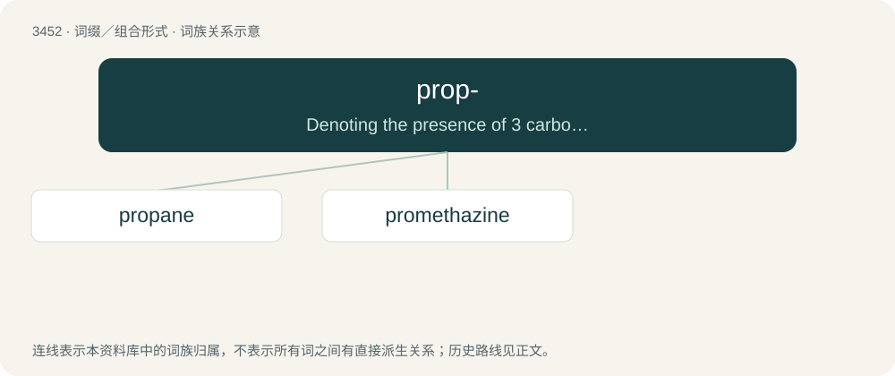

# 3533 · prop- — Denoting the presence of 3 carbon atoms in the parent chain when forming names of organic compounds.

[总目录](../00_总目录_按常用程度.md)

**类型**：词缀／组合形式　｜　**来源语言**：见词源记录

## 核心含义与来源

- 核心含义：Denoting the presence of 3 carbon atoms in the parent chain when forming names of organic compounds.
- 英文含义：Denoting the presence of 3 carbon atoms in the parent chain when forming names of organic compounds.
- 词形：prop-

**来源记录 1**（前缀／前置成分；Denoting the presence of 3 carbon atoms in the parent chain when forming names of organic compounds.）

By false splitting from propionic or directly from French propionique. Ultimately from Ancient Greek πρῶτος (prôtos, “first”) and πίων (píōn, “fat”).

## 词族图

## 单词速览（常用到不常用）

| 单词 | 音标 | 释义 |
|---|---|---|
| [propane](#w-1) | /ˈpɹoʊpeɪn/ | n. 丙烷；\[化\] 丙烷 |
| [promethazine](#w-2) | 英 /pɹəʊˈmɛ.θə.ziːn/；美 /pɹoʊˈmɛ.θəˌzin/ | n. \[药\]普鲁米近,异丙嗪,抗胺荨(一种抗过敏及安定药) |

## 逐词详解

### 1. propane

**词性**：名词　｜　**音标**：/ˈpɹoʊpeɪn/

**中文释义**：n. 丙烷；\[化\] 丙烷

**英文义项**：An aliphatic hydrocarbon, C₃H₈, a constituent of natural gas. / LPG.

**构词拆分**：prop- + -ane

**词源与演化**：

From clipping of propionic acid + -ane, from French propionique, from Ancient Greek πρό (pró) + πίων (píōn, “fat”). Analyzable as prop- + -ane, borrowing or calque of German Propan.

**例句**：

> It's a show about a propane salesman and his family.

### 2. promethazine

**词性**：名词　｜　**音标**：英 /pɹəʊˈmɛ.θə.ziːn/；美 /pɹoʊˈmɛ.θəˌzin/

**中文释义**：n. \[药\]普鲁米近,异丙嗪,抗胺荨(一种抗过敏及安定药)

**英文义项**：A first-generation H₁ receptor antagonist derived from phenothiazine, used as antihistamine and antiemetic medication with strong sedative effects.

**构词拆分**：From pro(p)- + meth- + (phenothi)azine.

**词源与演化**：

From pro(p)- + meth- + (phenothi)azine.
