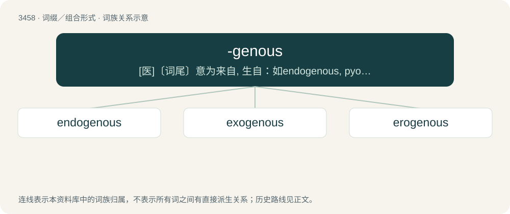

# 3539 · -genous — \[医\]〔词尾〕意为来自, 生自：如endogenous, pyogenous

[总目录](../00_总目录_按常用程度.md)

**类型**：词缀／组合形式　｜　**来源语言**：见词源记录

## 核心含义与来源

- 核心含义：\[医\]〔词尾〕意为来自, 生自：如endogenous, pyogenous
- 英文含义：Producing or yielding.
- 词形：-genous

**来源记录 1**（后缀／后置成分；Producing or yielding.）

From -gen + -ous.

## 词族图

## 单词速览（常用到不常用）

| 单词 | 音标 | 释义 |
|---|---|---|
| [endogenous](#w-1) | 英 /ɛnˈdɒd͡ʒ.ɪ.nəs/；美 /ɛnˈdɑ.d͡ʒə.nəs/ | a. 内源的；\[医\] 内生的, 内原的 |
| [exogenous](#w-2) | 英 /ɛkˈsɒd͡ʒ.ɪ.nəs/；美 /ɛkˈsɑ.d͡ʒə.nəs/ | a. 外生的；\[医\] 外原的, 外生的 |
| [erogenous](#w-3) | /əˈɹɒd͡ʒɪnəs/ | a. 唤起情欲的, 性感的；\[医\] 性欲发生的 |

## 逐词详解

### 1. endogenous

**词性**：形容词　｜　**音标**：英 /ɛnˈdɒd͡ʒ.ɪ.nəs/；美 /ɛnˈdɑ.d͡ʒə.nəs/

**中文释义**：a. 内源的；\[医\] 内生的, 内原的

**英文义项**：Produced, originating or growing from within. / Of a natural process: caused by factors within the body.

**构词拆分**：endogen + -ous；endo- + -genous

**词源与演化**：

From endogen + -ous or endo- + -genous. Piecewise doublet of indigenous.

### 2. exogenous

**词性**：形容词　｜　**音标**：英 /ɛkˈsɒd͡ʒ.ɪ.nəs/；美 /ɛkˈsɑ.d͡ʒə.nəs/

**中文释义**：a. 外生的；\[医\] 外原的, 外生的

**英文义项**：Produced or originating outside of the referent organism. / Growing as an exogen, by successive additions to the outside.

**构词拆分**：exo- + -genous

**词源与演化**：

From exo- + -genous.

### 3. erogenous

**词性**：形容词　｜　**音标**：/əˈɹɒd͡ʒɪnəs/

**中文释义**：a. 唤起情欲的, 性感的；\[医\] 性欲发生的

**英文义项**：Sensitive to sexual arousal. / Causing sexual arousal; erotogenic.

**词源与演化**：

From Ancient Greek ἔρως (érōs, “love”) + English -genous (“producing”).

**用法示例／搭配（非完整句）**：

> give him an erogenous massage

该用例对应义项：Causing sexual arousal; erotogenic.
