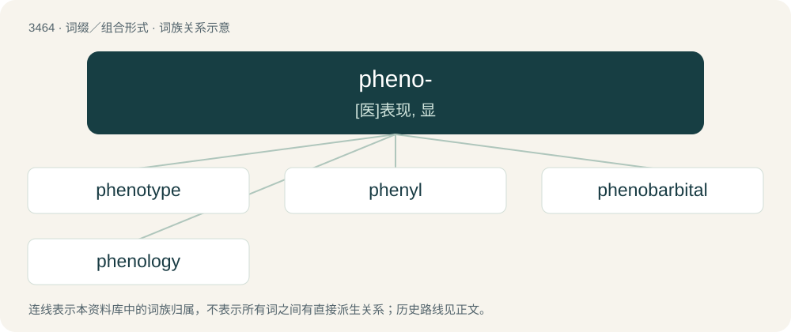

# 3546 · pheno- — \[医\]表现, 显

[总目录](../00_总目录_按常用程度.md)

**类型**：词缀／组合形式　｜　**来源语言**：见词源记录

## 核心含义与来源

- 核心含义：\[医\]表现, 显
- 英文含义：Showing.
- 词形：pheno-

## 词族图

## 单词速览（常用到不常用）

| 单词 | 音标 | 释义 |
|---|---|---|
| [phenotype](#w-1) | 英 /ˈfiː.nə(ʊ)ˌtaɪp/；美 /ˈfiː.nəˌtaɪp/ | n. 表现型, 有共同表现型的生物群体, 遗传环境互应结果；\[医\] 表型, 显型 |
| [phenyl](#w-2) | 英 /ˈfiː.naɪl/；美 /ˈfɛn.l̩/ | n. 苯基；\[化\] 苯基 |
| [phenobarbital](#w-3) | 英 /ˌfiː.nə(ʊ)ˈbɑː.bɪt.əl/；美 /ˌfiː.noʊˈbɑɹ.bəˌtɔl/ | n. 苯巴比妥；\[化\] 苯巴比妥 |
| [phenology](#w-4) | /ˌfɛnˈɒlədʒi/ | n. 物候学, 物候关系；\[医\] 物候学 |

## 逐词详解

### 1. phenotype

**词性**：名词　｜　**音标**：英 /ˈfiː.nə(ʊ)ˌtaɪp/；美 /ˈfiː.nəˌtaɪp/

**中文释义**：n. 表现型, 有共同表现型的生物群体, 遗传环境互应结果；\[医\] 表型, 显型

**英文义项**：The appearance of an organism based on a multifactorial combination of genetic traits and environmental factors, especially used in pedigrees. / Any observable characteristic of an organism, such as its morphological, developmental, biochemical or physiological properties, or its behavior.

**构词拆分**：pheno- + -type

**词源与演化**：

From pheno- + -type, from Ancient Greek φαίνω (phaínō, “to shine, to show, to appear”) + τύπος (túpos, “mark, type”).

**例句**：

> In biology, the students learn the difference between the genotype and the phenotype.

### 2. phenyl

**词性**：名词　｜　**音标**：英 /ˈfiː.naɪl/；美 /ˈfɛn.l̩/

**中文释义**：n. 苯基；\[化\] 苯基

**英文义项**：A univalent hydrocarbon radical, C₆H₅ (benzene minus one hydrogen atom), and the basis of an immense number of aromatic derivatives.

**构词拆分**：phen- + -yl

**词源与演化**：

Borrowed from French phényle, derived from the root of Ancient Greek φαίνω (phaínō, “to shine”) plus ὕλη (húlē, “wood; material, substance”). Equivalent to phen- + -yl.

### 3. phenobarbital

**词性**：名词　｜　**音标**：英 /ˌfiː.nə(ʊ)ˈbɑː.bɪt.əl/；美 /ˌfiː.noʊˈbɑɹ.bəˌtɔl/

**中文释义**：n. 苯巴比妥；\[化\] 苯巴比妥

**英文义项**：A narcotic and sedative barbiturate drug used chiefly to treat epilepsy.

**构词拆分**：pheno- + barbital

**词源与演化**：

From pheno- + barbital.

### 4. phenology

**词性**：名词　｜　**音标**：/ˌfɛnˈɒlədʒi/

**中文释义**：n. 物候学, 物候关系；\[医\] 物候学

**英文义项**：The study of the effect of climate on periodic biological phenomena.

**构词拆分**：pheno- + -ology

**词源与演化**：

From pheno- + -ology.
