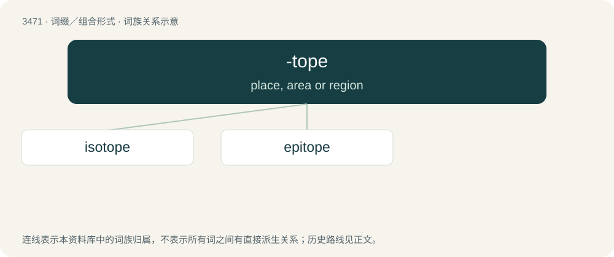

# 3549 · -tope — place, area or region

[总目录](../00_总目录_按常用程度.md)

**类型**：词缀／组合形式　｜　**来源语言**：见词源记录

## 核心含义与来源

- 核心含义：place, area or region
- 英文含义：place, area or region
- 词形：-tope

**来源记录 1**（后缀／后置成分；place, area or region）

From Ancient Greek τόπος (tópos, “place”).

## 词族图

## 单词速览（常用到不常用）

| 单词 | 音标 | 释义 |
|---|---|---|
| [isotope](#w-1) | 英 /ˈaɪ.sə.təʊp/；美 /ˈaɪ.sə.toʊp/ | n. 同位素；\[化\] 同位素 |
| [epitope](#w-2) | /ˈepitəup/ | n. \[生化\]抗原决定部位,抗原决定基 |

## 逐词详解

### 1. isotope

**词性**：名词　｜　**音标**：英 /ˈaɪ.sə.təʊp/；美 /ˈaɪ.sə.toʊp/

**中文释义**：n. 同位素；\[化\] 同位素

**英文义项**：Any of two or more forms of an element where the atoms have the same number of protons, but a different number of neutrons within their nuclei. Thus, isotopes have the same atomic number but a different mass number.

**构词拆分**：iso- (“equal”) + -tope (“place”)

**词源与演化**：

From iso- (“equal”) + -tope (“place”), because the different isotopes of an element always occupy the same place in the periodic table. The term was coined by Scottish doctor Margaret Todd in 1909 and first used publicly on February 27, 1913 by English chemist Frederick Soddy.

**例句**：

> The principal natural isotope of aluminium is aluminium-27.

### 2. epitope

**词性**：名词　｜　**音标**：/ˈepitəup/

**中文释义**：n. \[生化\]抗原决定部位,抗原决定基

**英文义项**：The part of a biomolecule (such as a protein) which is the target of an immune response

**构词拆分**：epi- + -tope

**词源与演化**：

From epi- + -tope.
