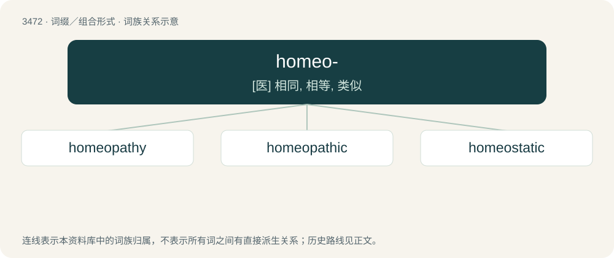

# 3550 · homeo- — \[医\] 相同, 相等, 类似

[总目录](../00_总目录_按常用程度.md)

**类型**：词缀／组合形式　｜　**来源语言**：见词源记录

## 核心含义与来源

- 核心含义：\[医\] 相同, 相等, 类似
- 英文含义：similar
- 词形：homeo-

**来源记录 1**（前缀／前置成分；similar）

Borrowed from Ancient Greek ὅμοιος (hómoios, “similar”).

## 词族图

## 单词速览（常用到不常用）

| 单词 | 音标 | 释义 |
|---|---|---|
| [homeopathy](#w-1) | 英 /ˌhəʊmɪˈɒpəθi/；美 /ˌhoʊmiˈɑpəθi/ | n. 顺势疗法；\[医\] 顺势疗法 |
| [homeopathic](#w-2) | /ˈhəumiəu,pæθik/ | \[医\] 顺势医疗的 |
| [homeostatic](#w-3) | 美 /ˌhoʊmioʊˈstætɪk/ | a. 体内平衡, 内环境稳定；\[医\] 内环境稳定的 |

## 逐词详解

### 1. homeopathy

**词性**：名词　｜　**音标**：英 /ˌhəʊmɪˈɒpəθi/；美 /ˌhoʊmiˈɑpəθi/

**中文释义**：n. 顺势疗法；\[医\] 顺势疗法

**英文义项**：A system of treating diseases with small amounts of substances which, in larger amounts, would produce the observed symptoms.

**构词拆分**：homeo- + -pathy

**词源与演化**：

From German Homöopathie, equivalent to English homeo- + -pathy.

**例句**：

> Homeopathy is considered a pseudoscience and is no more effective than placebos.

### 2. homeopathic

**词性**：形容词　｜　**音标**：/ˈhəumiəu,pæθik/

**中文释义**：\[医\] 顺势医疗的

**英文义项**：Of or pertaining to homeopathy. / Extremely dilute, insipid.

**构词拆分**：homeo- + -pathic

**词源与演化**：

From homeo- (“similar”) + -pathic (“suffering, disease”).

**例句**：

> His group compared studies of homeopathic treatments with studies of medical drugs.

### 3. homeostatic

**词性**：形容词　｜　**音标**：美 /ˌhoʊmioʊˈstætɪk/

**中文释义**：a. 体内平衡, 内环境稳定；\[医\] 内环境稳定的

**英文义项**：Of or pertaining to homeostasis.

**构词拆分**：homeo- + -static

**词源与演化**：

From homeo- + -static.

**例句**：

> Multicellular organisms require a homeostatic internal environment in order to live.

该用例对应义项：Of or pertaining to homeostasis.
