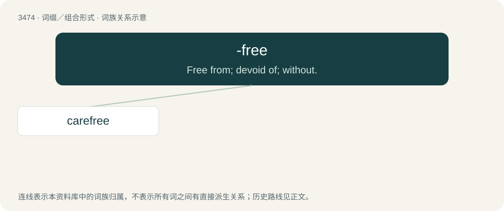

# 3551 · -free — Free from; devoid of; without.

[总目录](../00_总目录_按常用程度.md)

**类型**：词缀／组合形式　｜　**来源语言**：见词源记录

## 核心含义与来源

- 核心含义：Free from; devoid of; without.
- 英文含义：Free from; devoid of; without.
- 词形：-free

**来源记录 1**（后缀／后置成分；Free from; devoid of; without.）

From Middle English -fre, -freo (as in scotfre, gauelfre, gafolfreo, etc.), from Old English -frēo ("free; free from"; as in scotfrēo, gafolfrēo), from Proto-West Germanic \*-frī (“-free”). Compare Dutch -vrij (“-free”), German -frei (“-free”), Danish -fri (“-free”), Swedish -fri (“-free”), Norwegian -fri (“-free”). More at free.

## 词族图

## 单词速览（常用到不常用）

| 单词 | 音标 | 释义 |
|---|---|---|
| [carefree](#w-1) | 英 /ˈkɛəfɹiː/；美 /ˈkɛɚfɹi/ | a. 无忧无虑的, 不负责的 |

## 逐词详解

### 1. carefree

**词性**：形容词　｜　**音标**：英 /ˈkɛəfɹiː/；美 /ˈkɛɚfɹi/

**中文释义**：a. 无忧无虑的, 不负责的

**英文义项**：Without cares or worries; free of concern or worries; without difficulty.

**构词拆分**：care + -free

**词源与演化**：

From care + -free.

**例句**：

> He left his cell phone behind and enjoyed a carefree summer day at the beach.

该用例对应义项：Without cares or worries; free of concern or worries; without difficulty.
