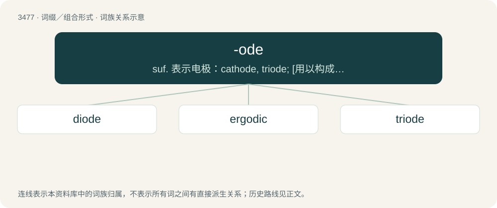

# 3555 · -ode — suf. 表示电极：cathode, triode; \[用以构成名词\]表示...性质的东西, 像...的东西：nematode, phyllode

[总目录](../00_总目录_按常用程度.md)

**类型**：词缀／组合形式　｜　**来源语言**：见词源记录

## 核心含义与来源

- 核心含义：suf. 表示电极：cathode, triode; \[用以构成名词\]表示...性质的东西, 像...的东西：nematode, phyllode
- 英文含义：Way, path, travel.
- 词形：-ode

**多个词源／构词路径**：同一拼写可能有不同来源；以下按词性和含义分别列出。

**来源记录 1**（后缀／后置成分；Way, path, travel.）

Borrowed from Ancient Greek ὁδός (hodós, “road, path, way, journey, travel, means, method, system”).

**来源记录 2**（后缀／后置成分；Characterized by.）

From Ancient Greek -ώδης (-ṓdēs, “form, likeness”).

## 词族图

## 单词速览（常用到不常用）

| 单词 | 音标 | 释义 |
|---|---|---|
| [diode](#w-1) | 英 /ˈdaɪ.əʊd/；美 /ˈdaɪ.oʊd/ | n. 二极管；\[化\] 二极管 |
| [ergodic](#w-2) | /ɜɹˈɡɑdɪk/ | \[计\] 遍历的 |
| [triode](#w-3) | 英 /ˈtɹaɪ.əʊd/；美 /ˈtɹaɪ.oʊd/ | n. 三极管；\[化\] 三极管 |

## 逐词详解

### 1. diode

**词性**：名词　｜　**音标**：英 /ˈdaɪ.əʊd/；美 /ˈdaɪ.oʊd/

**中文释义**：n. 二极管；\[化\] 二极管

**英文义项**：An electronic device that allows current to flow in one direction only; used chiefly as a rectifier.

**构词拆分**：di- (“two”) + -ode

**词源与演化**：

From di- (“two”) + -ode. Learned formation, coined by William Henry Eccles in 1919, after Ancient Greek δίοδος (díodos, “passage through”), which however is formed not with δι- (di-, “two”) but with δια- (dia-, “through”).

### 2. ergodic

**词性**：形容词　｜　**音标**：/ɜɹˈɡɑdɪk/

**中文释义**：\[计\] 遍历的

**英文义项**：Of or relating to certain systems that, given enough time, will eventually return to a previously experienced state. / Of or relating to a process in which every sequence or sample of sufficient size is equally representative of the whole.

**构词拆分**：ergo- + -ode

**词源与演化**：

International Scientific Vocabulary ergo- + -ode (+ -ic). The etymological origin is disputed: ἔργον (érgon) + ὁδός (hodós, “way”) versus ἔργον (érgon) + εἶδος (eîdos, “image”).

### 3. triode

**词性**：名词　｜　**音标**：英 /ˈtɹaɪ.əʊd/；美 /ˈtɹaɪ.oʊd/

**中文释义**：n. 三极管；\[化\] 三极管

**英文义项**：A thermionic valve containing an anode, a cathode, and a control grid; small changes to the charge on the grid control the flow from cathode to anode, which makes amplification possible.

**构词拆分**：tri- + -ode

**词源与演化**：

From tri- + -ode.
