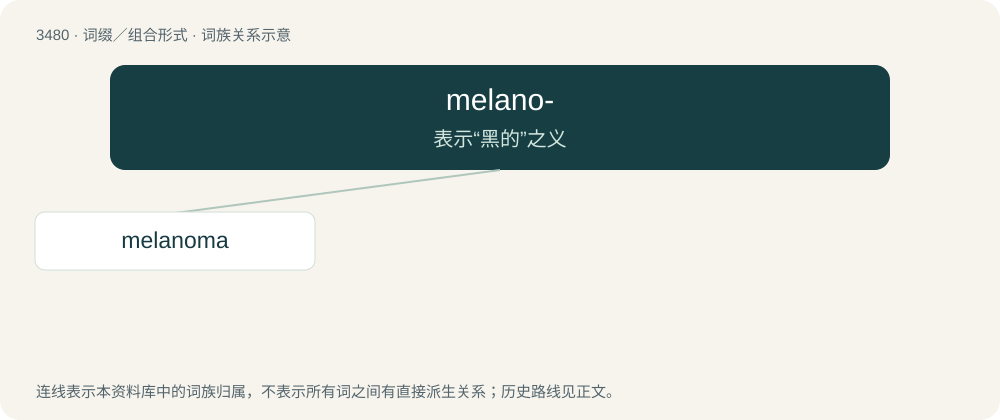

# 3556 · melano- — 表示“黑的”之义

[总目录](../00_总目录_按常用程度.md)

**类型**：词缀／组合形式　｜　**来源语言**：见词源记录

## 核心含义与来源

- 核心含义：表示“黑的”之义
- 英文含义：Black (color, of anything).
- 词形：melano-

**来源记录 1**（前缀／前置成分；Black (color, of anything).）

From the combining form of Ancient Greek μέλᾱς (mélās, “dark, black”).

## 词族图

## 单词速览（常用到不常用）

| 单词 | 音标 | 释义 |
|---|---|---|
| [melanoma](#w-1) | /mɛləˈnoʊmə/ | n. 黑瘤；\[医\] │黑瘤, 黑素瘤 |

## 逐词详解

### 1. melanoma

**词性**：名词　｜　**音标**：/mɛləˈnoʊmə/

**中文释义**：n. 黑瘤；\[医\] │黑瘤, 黑素瘤

**英文义项**：A dark-pigmented, usually malignant tumor arising from a melanocyte and occurring most commonly in the skin.

**构词拆分**：melano- + -oma

**词源与演化**：

From melano- + -oma.

**例句**：

> Melanoma's ABCDE stands for: Asymmetry, irregular borders, changing color, great diameter, and elevation above the skin.
