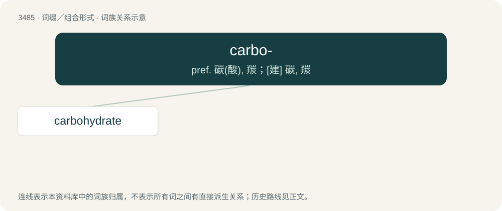

# 3561 · carbo- — pref. 碳(酸), 羰；\[建\] 碳, 羰

[总目录](../00_总目录_按常用程度.md)

**类型**：词缀／组合形式　｜　**来源语言**：见词源记录

## 核心含义与来源

- 核心含义：pref. 碳(酸), 羰；\[建\] 碳, 羰
- 英文含义：Carbon, carbonic, carbonyl, carbonylic, carboxyl or carboxylic.
- 词形：carbo-

## 词族图

## 单词速览（常用到不常用）

| 单词 | 音标 | 释义 |
|---|---|---|
| [carbohydrate](#w-1) | 英 /kɑːbəʊˈhaɪdɹeɪt/；美 /kɑɹboʊˈhaɪdɹeɪt/ | n. 碳水化合物, 糖类；\[化\] 糖类; 碳水化合物 |

## 逐词详解

### 1. carbohydrate

**词性**：名词　｜　**音标**：英 /kɑːbəʊˈhaɪdɹeɪt/；美 /kɑɹboʊˈhaɪdɹeɪt/

**中文释义**：n. 碳水化合物, 糖类；\[化\] 糖类; 碳水化合物

**英文义项**：A sugar, starch, or cellulose that is a food source of energy for an animal or plant. / Any food rich in starch or other carbohydrates.

**构词拆分**：carbo- + hydrate

**词源与演化**：

From their general formula Cₙ(H₂O)ₙ; they were once thought to be hydrates of carbon.

**例句**：

> I'm cutting down on carbohydrates like bread and pasta.

该用例对应义项：Any food rich in starch or other carbohydrates.
