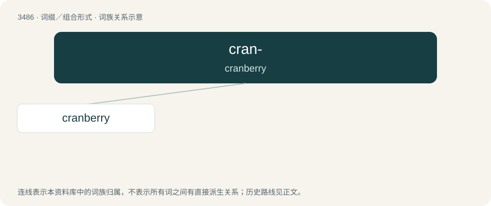

# 3563 · cran- — cranberry

[总目录](../00_总目录_按常用程度.md)

**类型**：词缀／组合形式　｜　**来源语言**：见词源记录

## 核心含义与来源

- 核心含义：cranberry
- 英文含义：cranberry
- 词形：cran-

## 词族图

## 单词速览（常用到不常用）

| 单词 | 音标 | 释义 |
|---|---|---|
| [cranberry](#w-1) | 英 /ˈkræn.b(ə).ri/；美 /ˈkɹæn.bɛr.i/ | n. 越橘 |

## 逐词详解

### 1. cranberry

**词性**：名词　｜　**音标**：英 /ˈkræn.b(ə).ri/；美 /ˈkɹæn.bɛr.i/

**中文释义**：n. 越橘

**英文义项**：A shrub belonging to the section Vaccinium sect. Oxycoccus of the genus Vaccinium. / The edible red berry of that shrub.

**构词拆分**：cran- + berry

**词源与演化**：

Adapted in the 1640s from Dutch Low Saxon or German Low German Kraanbeere, from Kraan m (which means and is cognate with crane) + Beere f (which means and is cognate with berry). Equivalent to cran- + berry. Via PIE cognate with Polish żurawina, Ukrainian журавли́на (žuravlýna) (akin to жураве́ль (žuravélʹ, “crane”)); Latvian dzērvene &lt; dzērve (“crane”).

**例句**：

> Many will serve traditional foods like turkey, stuffing, sweet potatoes and cranberry sauce.
