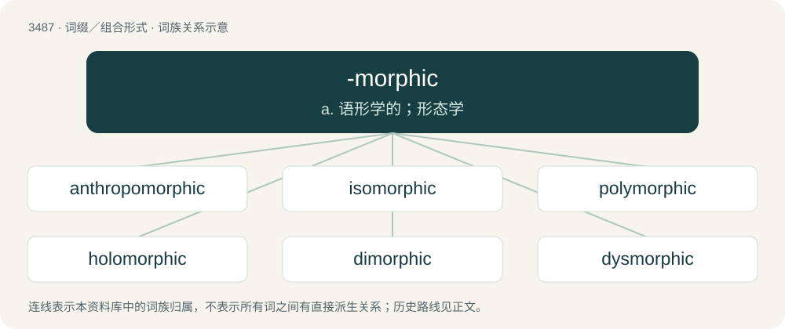

# 3564 · -morphic — a. 语形学的；形态学

[总目录](../00_总目录_按常用程度.md)

**类型**：词缀／组合形式　｜　**来源语言**：见词源记录

## 核心含义与来源

- 核心含义：a. 语形学的；形态学
- 英文含义：having a specific shape or form
- 词形：-morphic

**来源记录 1**（后缀／后置成分；having a specific shape or form）

From Ancient Greek μορφή (morphḗ, “form, shape”) + -ic, equivalent to -morph + -ic.

## 词族图

## 单词速览（常用到不常用）

| 单词 | 音标 | 释义 |
|---|---|---|
| [anthropomorphic](#w-1) | 英 /ˌænθɹəʊpəʊˈmɔːfɪk/；美 /ˌænθɹəpəˈmɔɹfɪk/ | a. 被赋于人形的；\[医\] 有人形的, 类人的 |
| [isomorphic](#w-2) | 英 /ˌaɪ.səˈmɔː.fɪk/；美 /ˌaɪ.soʊˈmɔɹ.fɪk/ | a. 同形的；\[医\] 同形的, \[异质\]同晶的 |
| [polymorphic](#w-3) | 美 /ˌpɑliˈmɔɹfɪk/ | \[计\] 多形的, 多种组合形式的；\[医\] 多形的 |
| [holomorphic](#w-4) | /,hɔləuˈmɔːfik/ | a. \[物\](晶体)对当的 |
| [dimorphic](#w-5) | 英 /daɪˈmɔːfɪk/；美 /ˌdaɪˈmɔɹfɪk/ | a. 双晶的, 同时具有两种特性的, 二形的, 二态的；\[化\] 双晶的 |
| [dysmorphic](#w-6) | 美 /ˌdɪsˈmɔɹfɪk/ | \[医\]同质异形的, 异形的 |

## 逐词详解

### 1. anthropomorphic

**词性**：形容词　｜　**音标**：英 /ˌænθɹəʊpəʊˈmɔːfɪk/；美 /ˌænθɹəpəˈmɔɹfɪk/

**中文释义**：a. 被赋于人形的；\[医\] 有人形的, 类人的

**英文义项**：Having the form of a human. / Having attributes or characteristics of a human being.

**构词拆分**：anthropo- + -morphic

**词源与演化**：

From anthropo- + -morphic.

**例句**：

> Like you, she thinks about languages in an anthropomorphic and anthropocentric way.

### 2. isomorphic

**词性**：形容词　｜　**音标**：英 /ˌaɪ.səˈmɔː.fɪk/；美 /ˌaɪ.soʊˈmɔɹ.fɪk/

**中文释义**：a. 同形的；\[医\] 同形的, \[异质\]同晶的

**英文义项**：Related by an isomorphism; having a structure-preserving one-to-one correspondence. / Having a similar structure or function to something that is not related genetically or through evolution.

**构词拆分**：iso- + -morphic

**词源与演化**：

From iso- + -morphic.

**用法示例／搭配（非完整句）**：

> an isomorphic JavaScript app

该用例对应义项：Able to run either client-side or server-side.

### 3. polymorphic

**词性**：形容词　｜　**音标**：美 /ˌpɑliˈmɔɹfɪk/

**中文释义**：\[计\] 多形的, 多种组合形式的；\[医\] 多形的

**英文义项**：Relating to polymorphism (any sense), able to have several shapes or forms. / Having or relating to the ability to take multiple data types for a single parameter.

**构词拆分**：poly- + -morphic

**词源与演化**：

From poly- + -morphic.

**例句**：

> Man is both polymorphic and polytypic.

该用例对应义项：having or occurring in several distinct forms

### 4. holomorphic

**词性**：形容词　｜　**音标**：/,hɔləuˈmɔːfik/

**中文释义**：a. \[物\](晶体)对当的

**英文义项**：Complex-differentiable on an open set around every point in its domain. / Having holohedral symmetry.

**构词拆分**：holo- + -morphic

**词源与演化**：

From holo- + -morphic.

**例句**：

> Holomorphic functions have several agreeable properties, making them easy to work with.

### 5. dimorphic

**词性**：形容词　｜　**音标**：英 /daɪˈmɔːfɪk/；美 /ˌdaɪˈmɔɹfɪk/

**中文释义**：a. 双晶的, 同时具有两种特性的, 二形的, 二态的；\[化\] 双晶的

**英文义项**：occurring or existing in two different forms / exhibiting dimorphism

**构词拆分**：di- + -morphic

**词源与演化**：

From di- + -morphic.

### 6. dysmorphic

**词性**：形容词　｜　**音标**：美 /ˌdɪsˈmɔɹfɪk/

**中文释义**：\[医\]同质异形的, 异形的

**英文义项**：Of, relative to, producing, or having dysmorphism. / Usually body dysmorphic: Having or relating to dysmorphia, also known as body dysmorphic disorder.

**构词拆分**：dys- + -morphic

**词源与演化**：

From dys- + -morphic.
