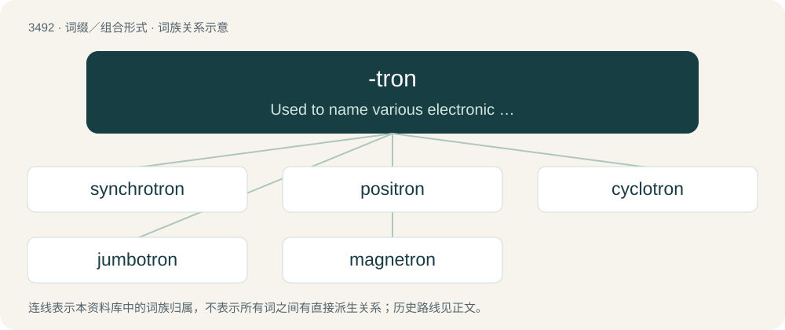

# 3567 · -tron — Used to name various electronic and neutronic devices.

[总目录](../00_总目录_按常用程度.md)

**类型**：词缀／组合形式　｜　**来源语言**：见词源记录

## 核心含义与来源

- 核心含义：Used to name various electronic and neutronic devices.
- 英文含义：Used to name various electronic and neutronic devices.
- 词形：-tron

**来源记录 1**（后缀／后置成分；Used to name various electronic and neutronic devices.）

Borrowed from Ancient Greek -τρον (-tron), a suffix denoting an instrument, as in Ancient Greek ἄροτρον (árotron, “plow”). The word cyclotron in particular has served as a motivation for use in high-technology terms. Compare also electron (and electronic), which is unrelated to the -τρον suffix.

## 词族图

## 单词速览（常用到不常用）

| 单词 | 音标 | 释义 |
|---|---|---|
| [synchrotron](#w-1) | /ˈsɪŋkɹə(ʊ)tɹɒn/ | n. 同步加速器；\[化\] 同步加速器 |
| [positron](#w-2) | 英 /ˈpɒz.ɪ.tɹɒn/；美 /ˈpɑ.zɪ.tɹɑn/ | n. 正电子；\[化\] 正子; 正电子 |
| [cyclotron](#w-3) | 英 /ˈsaɪ.klə.tɹɒn/；美 /ˈsaɪ.kləˌtɹɑn/ | n. 回旋加速器；\[化\] 回旋加速器 |
| [jumbotron](#w-4) | 英 /ˈd͡ʒʌm.bəʊˌtɹɒn/；美 /ˈd͡ʒʌm.boʊˌtɹɑn/ | 【英文】A very large video screen, typically used in a stadium or concert venue to show close-up shots. |
| [magnetron](#w-5) | 英 /ˈmæɡ.nətˌtɹɒn/；美 /ˈmæɡ.nətˌtɹɑn/ | n. 磁控管；\[化\] 磁控管 |

## 逐词详解

### 1. synchrotron

**词性**：名词　｜　**音标**：/ˈsɪŋkɹə(ʊ)tɹɒn/

**中文释义**：n. 同步加速器；\[化\] 同步加速器

**英文义项**：A form of cyclotron in which charged particles are accelerated by an electric field that is synchronized with a magnetic field that keeps them in a circular path.

**构词拆分**：synchro- + -tron

**词源与演化**：

From synchro- + -tron.

### 2. positron

**词性**：名词　｜　**音标**：英 /ˈpɒz.ɪ.tɹɒn/；美 /ˈpɑ.zɪ.tɹɑn/

**中文释义**：n. 正电子；\[化\] 正子; 正电子

**英文义项**：The antimatter equivalent of an electron, having the same mass but a positive charge.

**构词拆分**：positive + -tron

**词源与演化**：

From positive + -tron (electron). Coined by American physicist Carl Anderson in 1932 to replace the earlier term antielectron.

**例句**：

> The notion of a positron weapon remains the stuff of science fiction.

该用例对应义项：The antimatter equivalent of an electron, having the same mass but a positive charge.

### 3. cyclotron

**词性**：名词　｜　**音标**：英 /ˈsaɪ.klə.tɹɒn/；美 /ˈsaɪ.kləˌtɹɑn/

**中文释义**：n. 回旋加速器；\[化\] 回旋加速器

**英文义项**：An early particle accelerator in which charged particles were generated at a central source and accelerated spirally outward through a fixed magnetic field and alternating electric fields.

**构词拆分**：cyclo- + -tron

**词源与演化**：

From cyclo- + -tron.

### 4. jumbotron

**词性**：名词　｜　**音标**：英 /ˈd͡ʒʌm.bəʊˌtɹɒn/；美 /ˈd͡ʒʌm.boʊˌtɹɑn/

**英文义项**：A very large video screen, typically used in a stadium or concert venue to show close-up shots.

**构词拆分**：jumbo + -tron

**词源与演化**：

Genericized trademark from Sony's JumboTron, introduced in the 1980s and retired in 2001. From jumbo + -tron.

### 5. magnetron

**词性**：名词　｜　**音标**：英 /ˈmæɡ.nətˌtɹɒn/；美 /ˈmæɡ.nətˌtɹɑn/

**中文释义**：n. 磁控管；\[化\] 磁控管

**英文义项**：A device in which electrons are made to resonate in a specially shaped chamber and thus produce microwave radiation; used in radar, and in microwave ovens

**构词拆分**：magnet + -tron

**词源与演化**：

From magnet + -tron.
