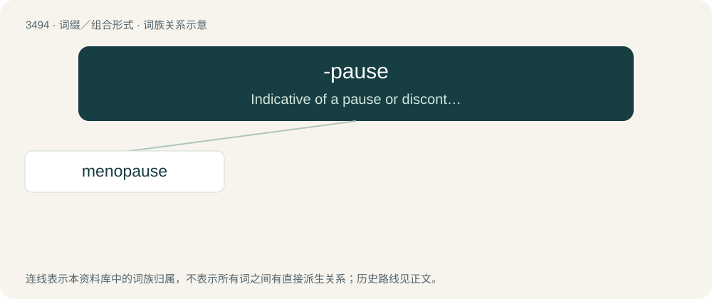

# 3568 · -pause — Indicative of a pause or discontinuance.

[总目录](../00_总目录_按常用程度.md)

**类型**：词缀／组合形式　｜　**来源语言**：见词源记录

## 核心含义与来源

- 核心含义：Indicative of a pause or discontinuance.
- 英文含义：Indicative of a pause or discontinuance.
- 词形：-pause

**来源记录 1**（后缀／后置成分；Indicative of a pause or discontinuance.）

From Middle French pause, from Latin pausa, from Ancient Greek παῦσις (paûsis, “discontinuance”).

## 词族图

## 单词速览（常用到不常用）

| 单词 | 音标 | 释义 |
|---|---|---|
| [menopause](#w-1) | /ˈmɛnəpɔːz/ | n. 绝经期；\[医\] 绝经 |

## 逐词详解

### 1. menopause

**词性**：名词　｜　**音标**：/ˈmɛnəpɔːz/

**中文释义**：n. 绝经期；\[医\] 绝经

**英文义项**：The period in a woman's life when menstruation becomes irregular and less frequent before eventually stopping altogether, usually accompanied by a range of unpleasant symptoms; the period spanning perimenopause up to postmenopause. / The final menstrual period of a woman after which ovulation no longer occurs.

**构词拆分**：meno- + -pause

**词源与演化**：

From French ménopause, from Latin menopausis, from Ancient Greek μήν (mḗn, “month”) + παῦσις (paûsis, “pause”). Equivalent to meno- + -pause.

**例句**：

> After menopause, women still want intercourse, but it becomes more intimate.
