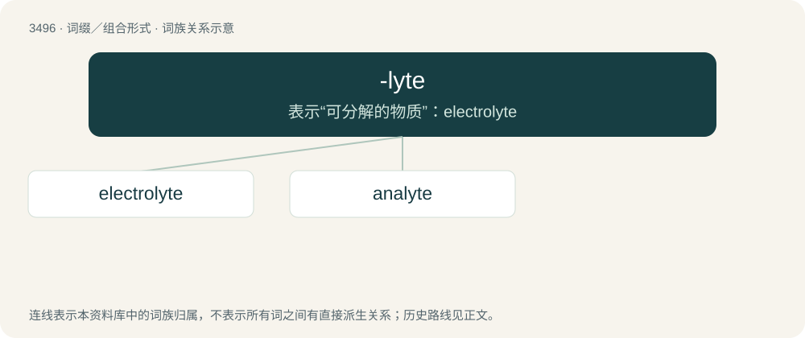

# 3573 · -lyte — 表示“可分解的物质”：electrolyte

[总目录](../00_总目录_按常用程度.md)

**类型**：词缀／组合形式　｜　**来源语言**：见词源记录

## 核心含义与来源

- 核心含义：表示“可分解的物质”：electrolyte
- 英文含义：Word-forming element used in making nouns corresponding to nouns in -lysis and adjectives in -lytic.
- 词形：-lyte

**来源记录 1**（后缀／后置成分；Word-forming element used in making nouns corresponding to nouns in -lysis and adjectives in -lytic.）

Borrowed from Ancient Greek λυτός (lutós, “loosed”), verbal adjective of λύειν (lúein, “to unfasten, loose, loosen, untie”).

## 词族图

## 单词速览（常用到不常用）

| 单词 | 音标 | 释义 |
|---|---|---|
| [electrolyte](#w-1) | 美 /ɪˈlɛk.tɹəˌlaɪt/ | n. 电解物, 电解质, 电解液；\[化\] 电解质 |
| [analyte](#w-2) | /ˈænəlait/ | \[化\] 分析物; 被分析物 |

## 逐词详解

### 1. electrolyte

**词性**：名词　｜　**音标**：美 /ɪˈlɛk.tɹəˌlaɪt/

**中文释义**：n. 电解物, 电解质, 电解液；\[化\] 电解质

**英文义项**：A substance that, in solution or when molten, ionizes and conducts electricity. / A solution containing such substances, which therefore also conducts electricity.

**构词拆分**：electro- + -lyte

**词源与演化**：

From electro- + -lyte, from electrolysis. Coined by British scientist Michael Faraday in 1834.

**例句**：

> Lab tests to consider under these circumstances include serum electrolytes, serum glucose, and urine protein.

该用例对应义项：Any of the various biometal ions (such as sodium or chloride) that regulate the electric charge on cells and the flow of water across their membranes, or (metonymically) such an ion's concentration in a bodily fluid, usually and especially blood, blood serum, or urine.

### 2. analyte

**词性**：名词　｜　**音标**：/ˈænəlait/

**中文释义**：\[化\] 分析物; 被分析物

**英文义项**：Any substance undergoing analysis.

**构词拆分**：ana- + -lyte

**词源与演化**：

From ana- + -lyte.
