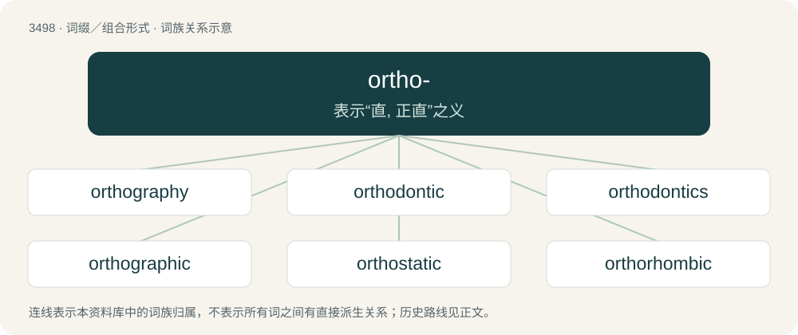

# 3575 · ortho- — 表示“直, 正直”之义

[总目录](../00_总目录_按常用程度.md)

**类型**：词缀／组合形式　｜　**来源语言**：见词源记录

## 核心含义与来源

- 核心含义：表示“直, 正直”之义
- 英文含义：Right angle, perpendicular.
- 词形：ortho-

## 词族图

## 单词速览（常用到不常用）

| 单词 | 音标 | 释义 |
|---|---|---|
| [orthography](#w-1) | 英 /ɔːˈθɒɡɹəfi/；美 /ɔɹˈθɑɡɹəfi/ | n. 正确拼字, 拼字法, 正字法 |
| [orthodontic](#w-2) |  | \[医\] 牙正常的 |
| [orthodontics](#w-3) | /,ɔːθəuˈdɔntiks/ | \[医\] 正牙学 |
| [orthographic](#w-4) | 英 /ˌɔːθəˈɡɹæfɪk/；美 /ˌɔːɹθəˈɡɹæfɪk/ | \[计\] 正射的 |
| [orthostatic](#w-5) | /,ɔːθəuˈstætik/ | \[医\] 直立的, 直体的 |
| [orthorhombic](#w-6) | /ɔː(ɹ)θəˈɹɒmbɪk/ | a. \[晶\]正交(晶)的,斜方晶系的 |
| [orthonormal](#w-7) | /,ɔːθəˈnɔːməl/ | \[计\] 规范正交的 |

## 逐词详解

### 1. orthography

**词性**：名词　｜　**音标**：英 /ɔːˈθɒɡɹəfi/；美 /ɔɹˈθɑɡɹəfi/

**中文释义**：n. 正确拼字, 拼字法, 正字法

**英文义项**：A method of representing a language or the sounds of language by written symbols; spelling. / A set of conventions for writing a language, including norms of spelling, capitalization, emphasis, hyphenation, punctuation, and word breaks.

**构词拆分**：ortho- (prefix meaning ‘proper, right; straight’) + -graphy (suffix denoting something written or otherwise represented in a specified manner, or about a specified subject)

**词源与演化**：

The noun is derived from Late Middle English ortografie, ortographie (“spelling”) \[and other forms\], and then either: \* from Anglo-Norman ortografie, Middle French orthographie, ortografie, ortographie (“correct spelling; orthographic projection”) (compare Old French ortografie; modern French orthographe (“spelling, orthography”), orthographie (“orthographic project, orthography”)); or \* from their etymon Latin orthographia (“correct spelling; building elevation”), from Koine Greek ὀρθογραφία (orthographía, “correct spelling”), from Ancient Greek ορθο- (ortho-, prefix meaning ‘right, proper; upright’) (from ὀρθός (orthós, “straight; erect, upright; correct, true”), ultimately from Proto-Indo-European \*h₃erdʰ- (“to grow, increase; high; upright”)) + -γραφίᾱ (-graphíā, suffix meaning ‘drawing; writing’) (from γρᾰ́φω (grắphō, “to cut into, scratch; to write”), ultimately from Proto-Indo-European \*gerbʰ- (“to carve”)). The English word is analyzable as ortho- (prefix meaning ‘proper, right; straight’) + -graphy (suffix denoting something written or otherwise represented in a specified manner, or about a specified subject). The verb is derived from the noun. First use appears before c. 1460. Cognates \* Catalan ortografia \* Italian ortografia \* Portuguese ortografia, orthografia (obsolete) \* Spanish ortografía

**例句**：

> No orthography has been developed for the written form of the language.

### 2. orthodontic

**词性**：形容词

**中文释义**：\[医\] 牙正常的

**英文义项**：Of, or relating to the dental speciality of orthodontics.

**构词拆分**：orthodontia + -ic；ortho- + -odont + -ic

**词源与演化**：

From orthodontia + -ic, equivalent to ortho- + -odont + -ic.

### 3. orthodontics

**词性**：名词　｜　**音标**：/,ɔːθəuˈdɔntiks/

**中文释义**：\[医\] 正牙学

**英文义项**：A specialty of dentistry concerned with correcting misalignment of teeth.

**构词拆分**：orthodontic + -s；ortho- (“correct, straight”) + -odont + -ics

**词源与演化**：

From orthodontic + -s, equivalent to ortho- (“correct, straight”) + -odont + -ics.

### 4. orthographic

**词性**：形容词　｜　**音标**：英 /ˌɔːθəˈɡɹæfɪk/；美 /ˌɔːɹθəˈɡɹæfɪk/

**中文释义**：\[计\] 正射的

**英文义项**：Of a projection used in maps, architecture etc., in which the rays are parallel. / Of, or relating to, orthography.

**构词拆分**：ortho- + -graph + -ic

**词源与演化**：

From ortho- + -graph + -ic. Compare French orthographique, Latin orthographus, Ancient Greek ὀρθογράφος (orthográphos).

**例句**：

> The orthographic neighbourhood effect makes it easier to recognize similar words.

### 5. orthostatic

**词性**：形容词　｜　**音标**：/,ɔːθəuˈstætik/

**中文释义**：\[医\] 直立的, 直体的

**英文义项**：Relating to orthostasis or orthostatism. / Relating to an orthostat.

**构词拆分**：ortho- + static

**词源与演化**：

From ortho- + static.

### 6. orthorhombic

**词性**：形容词　｜　**音标**：/ɔː(ɹ)θəˈɹɒmbɪk/

**中文释义**：a. \[晶\]正交(晶)的,斜方晶系的

**英文义项**：Having three unequal axes at right angles.

**构词拆分**：ortho- + rhombic

**词源与演化**：

A short form of the word pseudoorthorhombic; equivalent to ortho- + rhombic.

### 7. orthonormal

**词性**：形容词　｜　**音标**：/,ɔːθəˈnɔːməl/

**中文释义**：\[计\] 规范正交的

**英文义项**：Of a set of vectors, both orthogonal and normalized. / Of a linear transformation: that preserves both angles and lengths.

**构词拆分**：ortho- + normal

**词源与演化**：

Blend of orthogonal + normal, equivalent to ortho- + normal.
