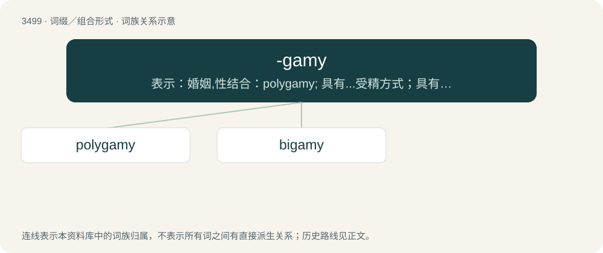

# 3576 · -gamy — 表示：婚姻,性结合：polygamy; 具有...受精方式；具有...生殖器官：cleistogamy

[总目录](../00_总目录_按常用程度.md)

**类型**：词缀／组合形式　｜　**来源语言**：见词源记录

## 核心含义与来源

- 核心含义：表示：婚姻,性结合：polygamy; 具有...受精方式；具有...生殖器官：cleistogamy
- 英文含义：Used to form nouns describing forms of marriage.
- 词形：-gamy

**来源记录 1**（后缀／后置成分；Used to form nouns describing forms of marriage.）

From Ancient Greek -γαμία (-gamía), from γάμος (gámos, “marriage”).

## 词族图

## 单词速览（常用到不常用）

| 单词 | 音标 | 释义 |
|---|---|---|
| [polygamy](#w-1) | /pəˈlɪɡ.ə.mi/ | n. 多配偶(制), 多偶性；\[医\] 多配\[合\](一雌多雄或一雄多雌,一妻多夫或一夫多妻) |
| [bigamy](#w-2) | 英 /ˈbɪɡəmi/ | n. 重婚, 重婚罪；\[法\] 重婚, 重婚罪 |

## 逐词详解

### 1. polygamy

**词性**：名词　｜　**音标**：/pəˈlɪɡ.ə.mi/

**中文释义**：n. 多配偶(制), 多偶性；\[医\] 多配\[合\](一雌多雄或一雄多雌,一妻多夫或一夫多妻)

**英文义项**：The condition of having more than one spouse or marriage partner at one time. / Synonym of polygyny (“marriage of a man to more than one wife, the practice of having several wives at the same time”).

**构词拆分**：poly- + -gamy

**词源与演化**：

Recorded since 1591, from Late Latin polygamia, from Ancient Greek πολυγαμία (polugamía), itself from πολύγαμος (polúgamos, “married to many”), from πολύς (polús, “many”) + γάμος (gámos, “marriage”). Relates to modern prefix and suffix poly- + -gamy.

**例句**：

> Though Islam allows polygamy, it is frowned upon in many contemporary Muslim societies.

该用例对应义项：Synonym of polygyny (“marriage of a man to more than one wife, the practice of having several wives at the same time”).

### 2. bigamy

**词性**：名词　｜　**音标**：英 /ˈbɪɡəmi/

**中文释义**：n. 重婚, 重婚罪；\[法\] 重婚, 重婚罪

**英文义项**：The state of having two (legal or illegal) spouses simultaneously. / A second marriage after the death of a spouse.

**构词拆分**：bi- + -gamy

**词源与演化**：

From Middle English bigamie (“having two spouses simultaneously, bigamy; second marriage; marrying a widow or widower”) \[and other forms\], from Anglo-Norman bigamie and Middle French bigamie (“having two spouses simultaneously; second marriage; marrying a widow or widower”) (modern French bigamie (“bigamy”)), and its etymon Late Latin bigamia (“having two spouses simultaneously; second marriage”), from Late Latin, Latin bigamus (“bigamous”) + -ia (variant of -ius (suffix forming adjectives from nouns)). Bigamus is derived from bis (“twice, two times”) + Ancient Greek γάμος (gámos, “marriage; matrimony”) (from Proto-Indo-European \*ǵem- (“to marry”)). The English word is analysable as bi- + -gamy.

**例句**：

> Bigamy is having one wife too many. Monogamy is the same.
