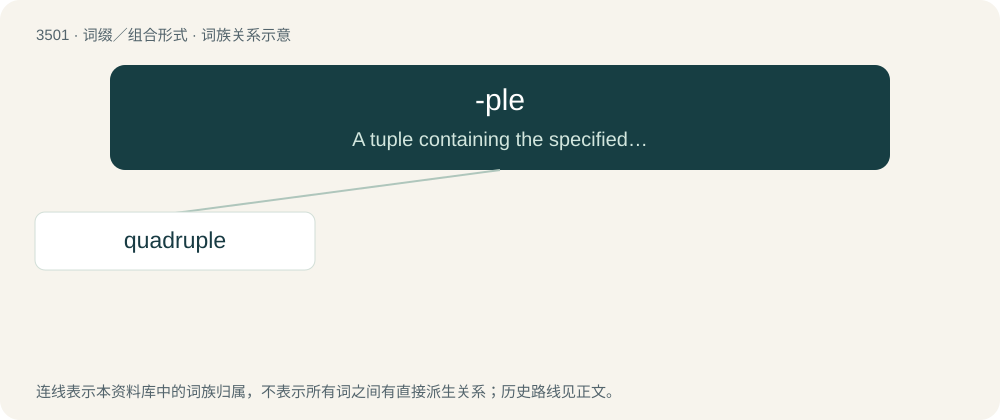

# 3577 · -ple — A tuple containing the specified number of terms.

[总目录](../00_总目录_按常用程度.md)

**类型**：词缀／组合形式　｜　**来源语言**：见词源记录

## 核心含义与来源

- 核心含义：A tuple containing the specified number of terms.
- 英文含义：A tuple containing the specified number of terms.
- 词形：-ple

**来源记录 1**（后缀／后置成分；A tuple containing the specified number of terms.）

From Latin -plus (“more, in sum”).

## 词族图

## 单词速览（常用到不常用）

| 单词 | 音标 | 释义 |
|---|---|---|
| [quadruple](#w-1) | 英 /ˈkwɒd.ɹʊ.pəl/；美 /kwɑˈdɹu.pəl/ | a. 四倍的, 四重的, 四部分组成的；n. 四倍；vt. 使成四倍 |

## 逐词详解

### 1. quadruple

**词性**：形容词　｜　**音标**：英 /ˈkwɒd.ɹʊ.pəl/；美 /kwɑˈdɹu.pəl/

**中文释义**：a. 四倍的, 四重的, 四部分组成的；n. 四倍；vt. 使成四倍

**英文义项**：Being four times as long, as big or as many of something.

**构词拆分**：quadri- + -ple

**词源与演化**：

From Middle English quadruple, from Latin quadruplus. Can be analyzed as quadri- + -ple.

**例句**：

> He's quite an athlete and can do quadruple jumps with ease.

该用例对应义项：Being four times as long, as big or as many of something.
