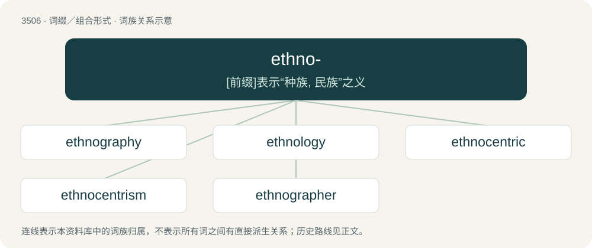

# 3581 · ethno- — \[前缀\]表示“种族, 民族”之义

[总目录](../00_总目录_按常用程度.md)

**类型**：词缀／组合形式　｜　**来源语言**：见词源记录

## 核心含义与来源

- 核心含义：\[前缀\]表示“种族, 民族”之义
- 英文含义：race; ethnicity (in the sense of classification of human beings).
- 词形：ethno-

**来源记录 1**（前缀／前置成分；race; ethnicity (in the sense of classification of human beings).）

From Ancient Greek ἔθνος (éthnos, “a company, later a people, nation”).

## 词族图

## 单词速览（常用到不常用）

| 单词 | 音标 | 释义 |
|---|---|---|
| [ethnography](#w-1) | 英 /ɛθˈnɒɡɹəfi/；美 /ɛθˈnɑɡɹəfi/ | n. 人种论, 人种学；\[医\] 人种志 |
| [ethnology](#w-2) | /eθˈnɒlədʒi/ | n. 人种学；\[医\] 人种学 |
| [ethnocentric](#w-3) | /,eθnəuˈsentrik/ | 种族\[民族\]中心主义的, 种族\[民族, 集团\]优越感的 |
| [ethnocentrism](#w-4) | /ˌɛθ.nəʊˈsɛn.tɹɪzm̩/ | n. 民族优越感 |
| [ethnographer](#w-5) | /eθˈnɒgrəfə/ | n. 人种志学者, 人种学者 |

## 逐词详解

### 1. ethnography

**词性**：名词　｜　**音标**：英 /ɛθˈnɒɡɹəfi/；美 /ɛθˈnɑɡɹəfi/

**中文释义**：n. 人种论, 人种学；\[医\] 人种志

**英文义项**：The branch of anthropology that scientifically describes specific human cultures and societies. / An ethnographic work.

**构词拆分**：ethno- + -graphy

**词源与演化**：

From ethno- + -graphy.

**例句**：

> Her ethnography of urban youth explored how music shapes identity and belonging.

### 2. ethnology

**词性**：名词　｜　**音标**：/eθˈnɒlədʒi/

**中文释义**：n. 人种学；\[医\] 人种学

**英文义项**：The branch of anthropology that compares and analyzes different human cultures and the relationships between them.

**构词拆分**：ethno- + -logy

**词源与演化**：

From ethno- + -logy.

**例句**：

> Every student of biology, anatomy, anthropology, ethnology or psychology is familiar with these facts.

### 3. ethnocentric

**词性**：形容词　｜　**音标**：/,eθnəuˈsentrik/

**中文释义**：种族\[民族\]中心主义的, 种族\[民族, 集团\]优越感的

**英文义项**：Of or pertaining to ethnocentrism.

**构词拆分**：ethno- + -centric

**词源与演化**：

From ethno- + -centric.

**例句**：

> The Abrahamic religions are deeply ethnocentric.

### 4. ethnocentrism

**词性**：名词　｜　**音标**：/ˌɛθ.nəʊˈsɛn.tɹɪzm̩/

**中文释义**：n. 民族优越感

**英文义项**：The tendency to look at the world primarily from the perspective of one's own traditional, deferred, or adoptive ethnic culture.

**构词拆分**：ethno- + -centrism

**词源与演化**：

From ethno- + -centrism.

**例句**：

> Monolingualism is like a disease, as it leads to ethnocentrism and culture isolation. But this disease can be cured.

### 5. ethnographer

**词性**：名词　｜　**音标**：/eθˈnɒgrəfə/

**中文释义**：n. 人种志学者, 人种学者

**英文义项**：One who practices ethnography.

**构词拆分**：ethno- + -grapher

**词源与演化**：

From ethno- + -grapher.
