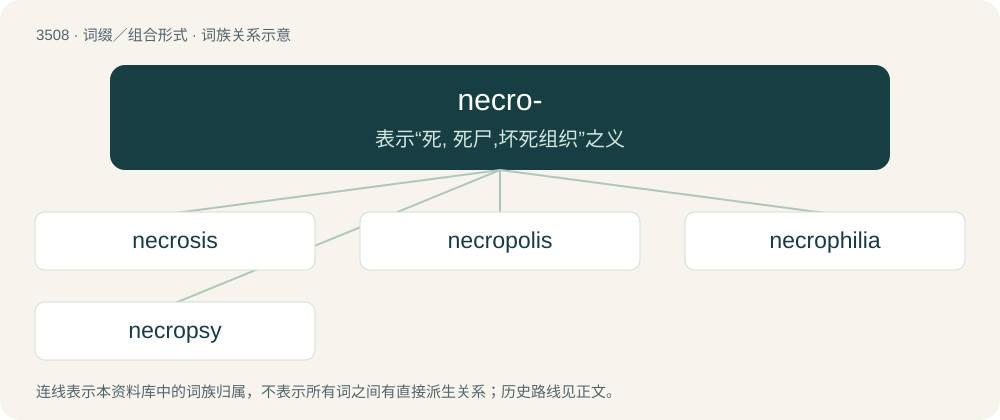

# 3582 · necro- — 表示“死, 死尸,坏死组织”之义

[总目录](../00_总目录_按常用程度.md)

**类型**：词缀／组合形式　｜　**来源语言**：见词源记录

## 核心含义与来源

- 核心含义：表示“死, 死尸,坏死组织”之义
- 英文含义：Death or dead tissue.
- 词形：necro-

**来源记录 1**（前缀／前置成分；Death or dead tissue.）

From Ancient Greek νεκρός (nekrós, “dead body”), from the Proto-Indo-European suffixed full-grade \*nekro- of \*neḱ- (“perish, disappear”); see also Middle Welsh angheu (“death”), Breton ankou, Old Irish éc, Latin noxius (“harmful”), nocēo (“to hurt, harm”), nex (“murder, violent death”) (as opposed to mors), Old Persian 𐎻𐎴𐎰𐎹𐎫𐎹 (vi-n-θ-y-t-y /⁠vi-nathayatiy⁠/, “he injures”), Avestan 𐬥𐬀𐬯𐬌𐬌𐬈𐬌𐬙𐬌 (nasiieⁱti, “disappears”), 𐬥𐬀𐬯𐬎- (nasu-, “corpse”), Sanskrit नश्यति (naśyati, “disappear, perish”). By surface analysis, necr- + -o-.

## 词族图

## 单词速览（常用到不常用）

| 单词 | 音标 | 释义 |
|---|---|---|
| [necrosis](#w-1) | 英 /nəˈkɹəʊ.sɪs/；美 /nɛˈkɹoʊ.sɪs/ | n. 坏死, 枯斑；\[医\] 坏死 |
| [necropolis](#w-2) | 英 /nɛˈkɹɒpəlɪs/；美 /nɛˈkɹɑpələs/ | n. 大墓地, 史前坟场 |
| [necrophilia](#w-3) | 英 /ˌnɛkɹə(ʊ)ˈfɪlɪə/；美 /nɛkɹoʊˈfɪli.ə/ | n. 恋尸狂；\[法\] 恋尸欲, 尸体色情, 奸尸 |
| [necropsy](#w-4) | 英 /ˈnɛkɹɒpsi/；美 /ˈnɛkɹɑpsi/ | n. 验尸；\[医\] 尸体剖检 |

## 逐词详解

### 1. necrosis

**词性**：名词　｜　**音标**：英 /nəˈkɹəʊ.sɪs/；美 /nɛˈkɹoʊ.sɪs/

**中文释义**：n. 坏死, 枯斑；\[医\] 坏死

**英文义项**：The localized death of cells or tissues through injury, disease, or the interruption of blood supply.

**构词拆分**：necro- + -osis

**词源与演化**：

From Ancient Greek νέκρωσις (nékrōsis), equivalent to necro- + -osis.

**例句**：

> Usually gangrene will follow necrosis unless the dead tissue is resected.

该用例对应义项：The localized death of cells or tissues through injury, disease, or the interruption of blood supply.

### 2. necropolis

**词性**：名词　｜　**音标**：英 /nɛˈkɹɒpəlɪs/；美 /nɛˈkɹɑpələs/

**中文释义**：n. 大墓地, 史前坟场

**英文义项**：A cemetery; especially a large one in or near a city. / An ancient site used for burying the dead, particularly if consisting of elaborate grave monuments.

**构词拆分**：necro- + -polis

**词源与演化**：

Borrowed from Koine Greek νεκρόπολις (nekrópolis, “city of the dead, cemetery”) (used to describe part of the city of Alexandria, Egypt), from Ancient Greek νεκρός (nekrós, “dead”) (ultimately from Proto-Indo-European \*neḱ- (“to disappear; to perish”)) + πόλις (pólis, “city”) (ultimately from Proto-Indo-European \*tpelH- (“city; fortification”)). The English word is analysable as necro- + -polis, and is cognate with French nécropole, German Nekropolis, Late Latin necropolis. The plural form necropoleis is derived from Ancient Greek νεκροπόλεις (nekropóleis).

**例句**：

> Thirteen completely sealed wooden coffins have been discovered in the necropolis of Saqqara in Egypt.

### 3. necrophilia

**词性**：名词　｜　**音标**：英 /ˌnɛkɹə(ʊ)ˈfɪlɪə/；美 /nɛkɹoʊˈfɪli.ə/

**中文释义**：n. 恋尸狂；\[法\] 恋尸欲, 尸体色情, 奸尸

**英文义项**：A pathological attraction to dead bodies. / Sexual activity with corpses.

**词源与演化**：

From necro- (Ancient Greek νεκρός (nekrós, “corpse, dead”)) + -philia (Ancient Greek φιλία (philía, “affection”)), after German Nekrophilie (in Krafft-Ebing 1887).

**例句**：

> Sami read anything related to necrophilia.

### 4. necropsy

**词性**：名词　｜　**音标**：英 /ˈnɛkɹɒpsi/；美 /ˈnɛkɹɑpsi/

**中文释义**：n. 验尸；\[医\] 尸体剖检

**英文义项**：The pathological examination of a corpse, particularly to determine cause of death.

**构词拆分**：necro- + -opsy

**词源与演化**：

From necro- + -opsy.
