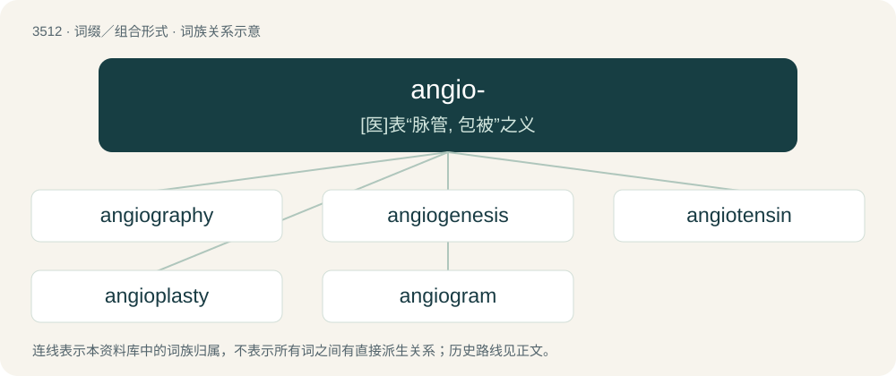

# 3584 · angio- — \[医\]表“脉管, 包被”之义

[总目录](../00_总目录_按常用程度.md)

**类型**：词缀／组合形式　｜　**来源语言**：见词源记录

## 核心含义与来源

- 核心含义：\[医\]表“脉管, 包被”之义
- 英文含义：vessel; relating to blood vessels, lymph vessels, or both.
- 词形：angio-

**来源记录 1**（前缀／前置成分；vessel; relating to blood vessels, lymph vessels, or both.）

From Ancient Greek ἀγγεῖον (angeîon, “vessel, urn, pot”), itself from ἄγγος (ángos, “vessel”).

## 词族图

## 单词速览（常用到不常用）

| 单词 | 音标 | 释义 |
|---|---|---|
| [angiography](#w-1) | 美 /ˌæn.d͡ʒiˈɑ.ɡɹə.fi/ | n. 血管造影术；\[医\] 血管造影术, 血管照相术, 血管学 |
| [angiogenesis](#w-2) | 英 /andʒɪə(ʊ)ˈdʒɛnɪsɪs/ | \[医\] 血管生成, 血管发生 |
| [angiotensin](#w-3) | 英 /ænd͡ʒɪəʊˈtɛnsɪn/；美 /ˌænd͡ʒɪoʊˈtɛnsɪn/ | n. 血管紧张素；\[化\] 血管紧张肽; 血管紧张素 |
| [angioplasty](#w-4) | /ˈæn.d͡ʒi.əʊ.plæs.ti/ | \[医\] 血管成形术 |
| [angiogram](#w-5) | /ˈændʒiəj^ræm/ | n. \[医\]血管造影(照)片 |

## 逐词详解

### 1. angiography

**词性**：名词　｜　**音标**：美 /ˌæn.d͡ʒiˈɑ.ɡɹə.fi/

**中文释义**：n. 血管造影术；\[医\] 血管造影术, 血管照相术, 血管学

**英文义项**：A medical imaging technique in which an X-ray image is taken to visualize the inside of blood vessels and organs of the body, with particular interest in the arteries, veins and the heart chambers.

**构词拆分**：angio- + -graphy

**词源与演化**：

From angio- + -graphy.

**例句**：

> I need to perform a pulmonary angiography.

### 2. angiogenesis

**词性**：名词　｜　**音标**：英 /andʒɪə(ʊ)ˈdʒɛnɪsɪs/

**中文释义**：\[医\] 血管生成, 血管发生

**英文义项**：The formation and development of new blood vessels.

**构词拆分**：angio- + -genesis

**词源与演化**：

From angio- + -genesis.

### 3. angiotensin

**词性**：名词　｜　**音标**：英 /ænd͡ʒɪəʊˈtɛnsɪn/；美 /ˌænd͡ʒɪoʊˈtɛnsɪn/

**中文释义**：n. 血管紧张素；\[化\] 血管紧张肽; 血管紧张素

**英文义项**：Any of several polypeptides that narrow blood vessels and thus regulate arterial pressure.

**构词拆分**：angio- + (hyper)tens(ion) + -in

**词源与演化**：

From angio- + (hyper)tens(ion) + -in. Compare also the morphologic parallels of vasopressin.

### 4. angioplasty

**词性**：名词　｜　**音标**：/ˈæn.d͡ʒi.əʊ.plæs.ti/

**中文释义**：\[医\] 血管成形术

**英文义项**：The mechanical widening of a narrowed or totally obstructed blood vessel generally caused by atheroma.

**构词拆分**：angio- + -plasty

**词源与演化**：

From angio- + -plasty.

### 5. angiogram

**词性**：名词　｜　**音标**：/ˈændʒiəj^ræm/

**中文释义**：n. \[医\]血管造影(照)片

**英文义项**：An X-ray image of the blood vessels gained after the injection of a radiopaque contrast medium.

**构词拆分**：angio- + -gram

**词源与演化**：

From angio- + -gram.

**例句**：

> The angiogram showed that his blood vessels were healthy.
