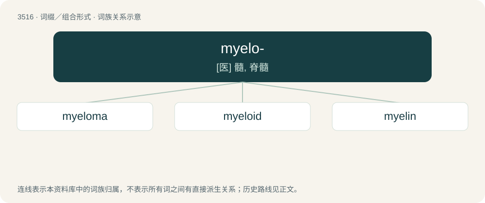

# 3587 · myelo- — \[医\] 髓, 脊髓

[总目录](../00_总目录_按常用程度.md)

**类型**：词缀／组合形式　｜　**来源语言**：见词源记录

## 核心含义与来源

- 核心含义：\[医\] 髓, 脊髓
- 英文含义：Bone marrow.
- 词形：myelo-

**来源记录 1**（前缀／前置成分；Bone marrow.）

From international scientific vocabulary, reflecting a New Latin combining form, from Ancient Greek μυελός (muelós, “marrow”).

## 词族图

## 单词速览（常用到不常用）

| 单词 | 音标 | 释义 |
|---|---|---|
| [myeloma](#w-1) | /,maiəˈləumə/ | n. 骨髓瘤；\[医\] 骨髓瘤 |
| [myeloid](#w-2) | /ˈmaɪəˌlɔɪd/ | 骨髓的, 骨髓状的, 由骨髓而来的 |
| [myelin](#w-3) | /ˈmaɪəlɪn/ | \[化\] 髓磷脂；\[医\] 髓磷脂; 髓鞘质 |

## 逐词详解

### 1. myeloma

**词性**：名词　｜　**音标**：/,maiəˈləumə/

**中文释义**：n. 骨髓瘤；\[医\] 骨髓瘤

**英文义项**：A malignant tumour arising from cells of the bone marrow, specifically plasma cells.

**构词拆分**：myelo- + -oma

**词源与演化**：

From myelo- + -oma.

**例句**：

> Multiple myeloma affects the plasma cells in the bone marrow and causes skeletal or soft tissue tumors. It is rarely cured.

### 2. myeloid

**词性**：形容词　｜　**音标**：/ˈmaɪəˌlɔɪd/

**中文释义**：骨髓的, 骨髓状的, 由骨髓而来的

**英文义项**：Of or pertaining to bone marrow. / Of or pertaining to the spinal cord.

**构词拆分**：myelo- + -oid

**词源与演化**：

From myelo- + -oid.

**例句**：

> Tom was diagnosed with acute myeloid leukemia in 2013.

### 3. myelin

**词性**：名词　｜　**音标**：/ˈmaɪəlɪn/

**中文释义**：\[化\] 髓磷脂；\[医\] 髓磷脂; 髓鞘质

**英文义项**：A white, fatty material, composed of lipids and lipoproteins, that surrounds the axons of nerves.

**构词拆分**：myelo- + -in

**词源与演化**：

From myelo- + -in. From Ancient Greek μυελός (muelós, “marrow”).
