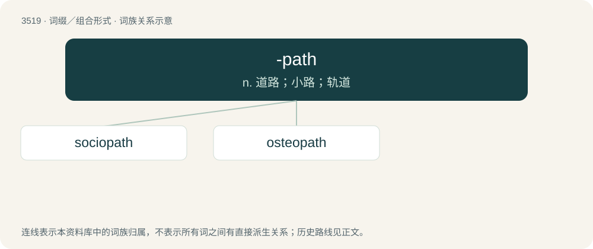

# 3589 · -path — n. 道路；小路；轨道

[总目录](../00_总目录_按常用程度.md)

**类型**：词缀／组合形式　｜　**来源语言**：见词源记录

## 核心含义与来源

- 核心含义：n. 道路；小路；轨道
- 英文含义：Used to form nouns indicating someone with a particular disorder
- 词形：-path

**来源记录 1**（后缀／后置成分；Used to form nouns indicating someone with a particular disorder）

From Ancient Greek πάθος (páthos, “suffering”).

## 词族图

## 单词速览（常用到不常用）

| 单词 | 音标 | 释义 |
|---|---|---|
| [sociopath](#w-1) | /ˈsəʊ.si.ə(ʊ)ˌpæθ/ | n. 反社会的人；\[医\] 反社会者(一种精神病人) |
| [osteopath](#w-2) | /ˈɒstiəpæθ/ | n. 整骨医生；\[医\] 按骨术医士 |

## 逐词详解

### 1. sociopath

**词性**：名词　｜　**音标**：/ˈsəʊ.si.ə(ʊ)ˌpæθ/

**中文释义**：n. 反社会的人；\[医\] 反社会者(一种精神病人)

**英文义项**：A person with an antisocial personality disorder.

**构词拆分**：socio- + -path

**词源与演化**：

From socio- + -path. First use appears c. 1914.

**例句**：

> The CEO of this large company is a narcissist and a sociopath.

### 2. osteopath

**词性**：名词　｜　**音标**：/ˈɒstiəpæθ/

**中文释义**：n. 整骨医生；\[医\] 按骨术医士

**英文义项**：A non-physician healthcare practitioner who practices osteopathy by manipulating the skeleton and muscles. Not to be confused with Doctors of Osteopathic Medicine (D.O.) (also known as osteopathic physicians) who are full physicians like Doctors of Medicine (M.D.).

**构词拆分**：osteo- + -path

**词源与演化**：

From osteo- + -path.
