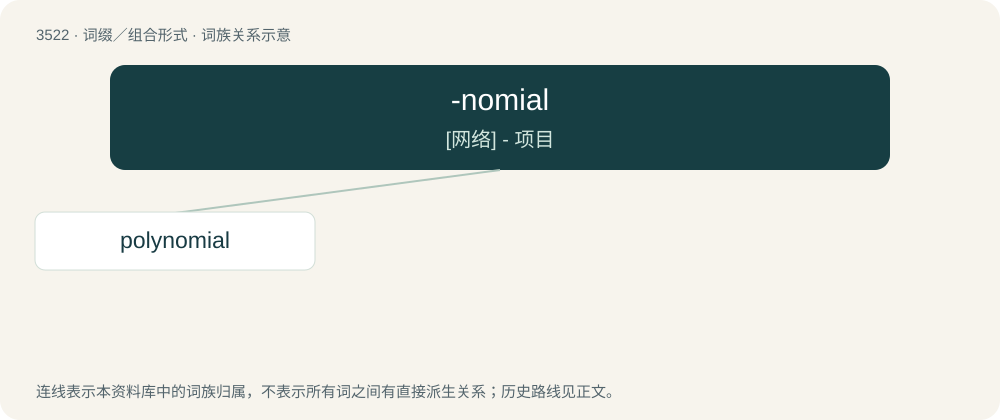

# 3593 · -nomial — \[网络\] - 项目

[总目录](../00_总目录_按常用程度.md)

**类型**：词缀／组合形式　｜　**来源语言**：见词源记录

## 核心含义与来源

- 核心含义：\[网络\] - 项目
- 英文含义：Denotes an expression with a specified number of terms.
- 词形：-nomial

**来源记录 1**（后缀／后置成分；Denotes an expression with a specified number of terms.）

Derived from Ancient Greek νομός (nomós, “portion, part”), compare binomial.

## 词族图

## 单词速览（常用到不常用）

| 单词 | 音标 | 释义 |
|---|---|---|
| [polynomial](#w-1) | 英 /ˌpɒlɪˈnəʊmɪəl/；美 /ˌpɑliˈnoʊmiəl/ | a. 多项式的, 多词学名的；n. 多项式, 多词学名；\[计\] 多项式 |

## 逐词详解

### 1. polynomial

**词性**：名词　｜　**音标**：英 /ˌpɒlɪˈnəʊmɪəl/；美 /ˌpɑliˈnoʊmiəl/

**中文释义**：a. 多项式的, 多词学名的；n. 多项式, 多词学名；\[计\] 多项式

**英文义项**：An expression consisting of a sum of a finite number of terms, each term being the product of a constant coefficient and one or more variables raised to a non-negative integer power, such as a\_nxⁿ+a\_n-1xⁿ⁻¹+...+a\_0x⁰. / A taxonomic designation (such as of a subspecies) consisting of more than two terms.

**构词拆分**：poly- + -nomial

**词源与演化**：

From poly- + -nomial, from νομός (nomós, “portion, part”), by analogy with binomial.

**例句**：

> No algorithm that can solve this problem in polynomial time has been found yet.
