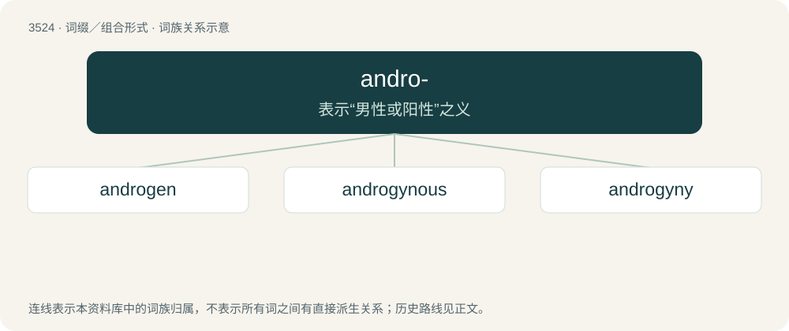

# 3596 · andro- — 表示“男性或阳性”之义

[总目录](../00_总目录_按常用程度.md)

**类型**：词缀／组合形式　｜　**来源语言**：见词源记录

## 核心含义与来源

- 核心含义：表示“男性或阳性”之义
- 英文含义：human
- 词形：andro-

**来源记录 1**（前缀／前置成分；human）

From Ancient Greek ἀνδρός (andrós), genitive of ἀνήρ (anḗr).

## 词族图

## 单词速览（常用到不常用）

| 单词 | 音标 | 释义 |
|---|---|---|
| [androgen](#w-1) | /ˈændrəd͡ʒən/ | n. 雄激素；\[化\] 雄性激素 |
| [androgynous](#w-2) | 英 /ænˈdɹɒd͡ʒ.ɪn.əs/；美 /ænˈdɹɑd͡ʒ.ən.əs/ | a. 雌雄同体的, 雌雄同序的, 两性畸形的；\[医\] 两性畸形的, 雌雄同体的, 男子女化的 |
| [androgyny](#w-3) | 英 /ænˈdɹɒdʒəni/；美 /ænˈdɹɑd͡ʒəni/ | \[医\] 两性畸形, 雌雄同体性, 男子女化(男性假两性畸形) |

## 逐词详解

### 1. androgen

**词性**：名词　｜　**音标**：/ˈændrəd͡ʒən/

**中文释义**：n. 雄激素；\[化\] 雄性激素

**英文义项**：Any natural or synthetic compound, usually a steroid hormone, that stimulates or controls the development and maintenance of masculine characteristics in vertebrates. A male sex hormone such as testosterone or anabolic steroids.

**构词拆分**：andro- + -gen

**词源与演化**：

From andro- + -gen.

### 2. androgynous

**词性**：形容词　｜　**音标**：英 /ænˈdɹɒd͡ʒ.ɪn.əs/；美 /ænˈdɹɑd͡ʒ.ən.əs/

**中文释义**：a. 雌雄同体的, 雌雄同序的, 两性畸形的；\[医\] 两性畸形的, 雌雄同体的, 男子女化的

**英文义项**：Possessing the sex organs of both sexes. / Pertaining to a feature or characteristic that is not definitively of either sex.

**构词拆分**：andro- + gyno- + -ous

**词源与演化**：

From Latin androgynus (“man-woman, hermaphrodite”), from Ancient Greek ἀνδρόγῠνος (andrógŭnos), from ἀνήρ (anḗr, “man”) + γῠνή (gŭnḗ, “woman”) + -ος (-os, “-ous”, adjectival suffix), equivalent to andro- + gyno- + -ous.

**例句**：

> Nicknames like Pat, Sam, and Chris are androgynous, used by both men and women.

该用例对应义项：Pertaining to a feature or characteristic that is not definitively of either sex.

### 3. androgyny

**词性**：名词　｜　**音标**：英 /ænˈdɹɒdʒəni/；美 /ænˈdɹɑd͡ʒəni/

**中文释义**：\[医\] 两性畸形, 雌雄同体性, 男子女化(男性假两性畸形)

**英文义项**：Hermaphroditism. / The state of having traits of both male and female genders.

**构词拆分**：andro- + -gyny

**词源与演化**：

From andro- + -gyny. See androgynous.
