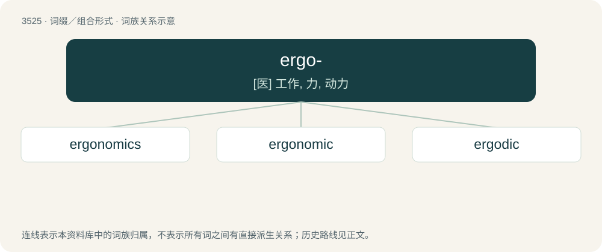

# 3597 · ergo- — \[医\] 工作, 力, 动力

[总目录](../00_总目录_按常用程度.md)

**类型**：词缀／组合形式　｜　**来源语言**：见词源记录

## 核心含义与来源

- 核心含义：\[医\] 工作, 力, 动力
- 英文含义：work
- 词形：ergo-

**来源记录 1**（前缀／前置成分；work）

Derived from Ancient Greek ἔργον (érgon).

## 词族图

## 单词速览（常用到不常用）

| 单词 | 音标 | 释义 |
|---|---|---|
| [ergonomics](#w-1) | 英 /ɜː.ɡəˈnɒm.ɪks/；美 /ˌɝ.ɡəˈnɑ.mɪks/ | n. 工效学, 人类工程学；\[化\] 工效学 |
| [ergonomic](#w-2) | /,\\\\ː^əjˈnɔmik/ | a. 人类环境改造学的 |
| [ergodic](#w-3) | /ɜɹˈɡɑdɪk/ | \[计\] 遍历的 |

## 逐词详解

### 1. ergonomics

**词性**：名词　｜　**音标**：英 /ɜː.ɡəˈnɒm.ɪks/；美 /ˌɝ.ɡəˈnɑ.mɪks/

**中文释义**：n. 工效学, 人类工程学；\[化\] 工效学

**英文义项**：The science of the design of equipment, especially so as to reduce operator fatigue, discomfort and injury. / Political economy.

**构词拆分**：ergo- + -nomics；ergo- (prefix indicating work) + -nomics (suffix indicating the rules of a discipline)

**词源与演化**：

From ergo- (prefix indicating work) + -nomics (suffix indicating the rules of a discipline), probably modelled after Polish ergonomia (“ergonomics”) (used by Polish scientist Wojciech Jastrzębowski (1799–1882) in an 1857 article), from Ancient Greek ἔργον (érgon, “work”) + νόμος (nómos, “custom; law, ordinance”). The English word is widely regarded as having been introduced by British psychologist K. F. Hywel Murrell at a meeting at the Admiralty in London in July 1949, which led to the establishment of the Ergonomics Research Society (now The Chartered Institute of Ergonomics and Human Factors) on 17 September 1949.

**例句**：

> Ergonomics is increasingly important in office-product design.

该用例对应义项：The science of the design of equipment, especially so as to reduce operator fatigue, discomfort and injury.

### 2. ergonomic

**词性**：形容词　｜　**音标**：/,\\\\ː^əjˈnɔmik/

**中文释义**：a. 人类环境改造学的

**英文义项**：Of or relating to the science of ergonomics. / Designed for comfort or to minimize fatigue.

**构词拆分**：ergo- + -nomy + -ic

**词源与演化**：

Dated 1950 C.E.; ergo- + -nomy + -ic, from Ancient Greek: ἔργον (érgon, “work”) and νόμος (nómos, “distribution”).

**例句**：

> The instrument panel has a very ergonomic layout.

### 3. ergodic

**词性**：形容词　｜　**音标**：/ɜɹˈɡɑdɪk/

**中文释义**：\[计\] 遍历的

**英文义项**：Of or relating to certain systems that, given enough time, will eventually return to a previously experienced state. / Of or relating to a process in which every sequence or sample of sufficient size is equally representative of the whole.

**构词拆分**：ergo- + -ode

**词源与演化**：

International Scientific Vocabulary ergo- + -ode (+ -ic). The etymological origin is disputed: ἔργον (érgon) + ὁδός (hodós, “way”) versus ἔργον (érgon) + εἶδος (eîdos, “image”).
