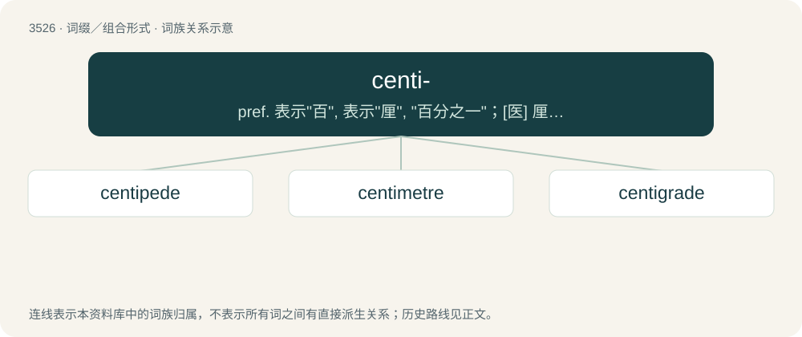

# 3601 · centi- — pref. 表示"百", 表示"厘", "百分之一"；\[医\] 厘, 百分

[总目录](../00_总目录_按常用程度.md)

**类型**：词缀／组合形式　｜　**来源语言**：见词源记录

## 核心含义与来源

- 核心含义：pref. 表示"百", 表示"厘", "百分之一"；\[医\] 厘, 百分
- 英文含义：one-hundredth
- 词形：centi-

**来源记录 1**（前缀／前置成分；one-hundredth）

From French centi- and its etymon Latin centi-, from centum (“hundred”). Doublet of hecato- and hecto-.

## 词族图

## 单词速览（常用到不常用）

| 单词 | 音标 | 释义 |
|---|---|---|
| [centipede](#w-1) | 英 /ˈsɛn.tɪ.pid/ | n. 百脚；\[医\] 蜈蚣 |
| [centimetre](#w-2) | 英 /ˈsɛn.tɪ.miː.tə/ | n. 厘米, 公分 |
| [centigrade](#w-3) | /ˈsentigreid/ | a. 百分度的, 摄氏的；\[医\] 百分度 |

## 逐词详解

### 1. centipede

**词性**：名词　｜　**音标**：英 /ˈsɛn.tɪ.pid/

**中文释义**：n. 百脚；\[医\] 蜈蚣

**英文义项**：Any arthropod of class Chilopoda, which have a segmented body with one pair of legs per segment and from about 20 to 300 legs in total. / A many-oared Chinese smuggling boat.

**构词拆分**：centi- + -pede

**词源与演化**：

From French centipède, from Latin centipeda, centipēs, from centi- (“hundred”) + pēs (“foot”); equivalent to centi- + -pede.

**例句**：

> Startled, Rodrigo froze in place as he observed the centipede's swift movements.

### 2. centimetre

**词性**：名词　｜　**音标**：英 /ˈsɛn.tɪ.miː.tə/

**中文释义**：n. 厘米, 公分

**英文义项**：An SI unit of length equal to 10⁻² metres. Symbol: cm

**构词拆分**：centi- + metre

**词源与演化**：

Borrowed from French centimètre; equivalent to centi- + metre.

**例句**：

> Plant in parallel rows, leaving a 20-centimetre gap between each row.

### 3. centigrade

**词性**：名词　｜　**音标**：/ˈsentigreid/

**中文释义**：a. 百分度的, 摄氏的；\[医\] 百分度

**英文义项**：A centigrade scale for temperature having the freezing point of water defined as 0° and its boiling point defined as 100° at standard atmospheric pressure. / A single degree on this scale.

**构词拆分**：centi- + grade

**词源与演化**：

From centi- (“hundred”) + grade (“degree”).

**用法示例／搭配（非完整句）**：

> all temperatures are expressed in centigrade unless otherwise noted

该用例对应义项：A centigrade scale for temperature having the freezing point of water defined as 0° and its boiling point defined as 100° at standard atmospheric pressure.
