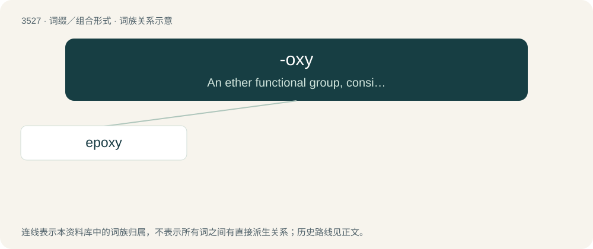

# 3603 · -oxy — An ether functional group, consisting of a carbon chain with an intervening oxygen atom at the attachment point.

[总目录](../00_总目录_按常用程度.md)

**类型**：词缀／组合形式　｜　**来源语言**：见词源记录

## 核心含义与来源

- 核心含义：An ether functional group, consisting of a carbon chain with an intervening oxygen atom at the attachment point.
- 英文含义：An ether functional group, consisting of a carbon chain with an intervening oxygen atom at the attachment point.
- 词形：-oxy

**来源记录 1**（后缀／后置成分；An ether functional group, consisting of a carbon chain with an intervening oxygen atom at the attachment point.）

From oxygen.

## 词族图

## 单词速览（常用到不常用）

| 单词 | 音标 | 释义 |
|---|---|---|
| [epoxy](#w-1) | 英 /ɪˈpɒk.si/；美 /ɪˈpɑk.si/ | a. 环氧的；\[化\] 环氧; 表氧; 桥氧 |

## 逐词详解

### 1. epoxy

**词性**：形容词　｜　**音标**：英 /ɪˈpɒk.si/；美 /ɪˈpɑk.si/

**中文释义**：a. 环氧的；\[化\] 环氧; 表氧; 桥氧

**英文义项**：Derived from an epoxide.

**构词拆分**：ep- + -oxy

**词源与演化**：

From ep- + -oxy.

**例句**：

> After bonding, more ductile epoxy is used to waterproof the bond.
