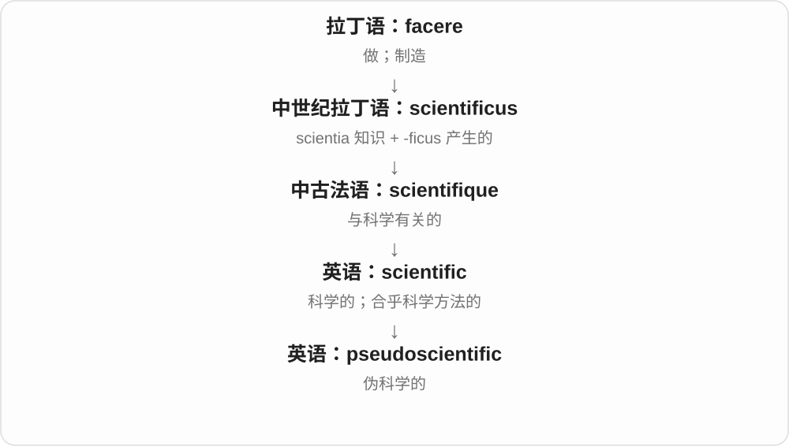

# 3603 · pseudo- — 假、伪、貌似；仿某种形式

[逐词精讲目录](../00_逐词精讲目录.md) · [总目录](../00_总目录_按常用程度.md)

## 核心词根与来源

来自希腊 pseudes 假的、虚假的，较早已进入英语，后成为常用学术、技术构词前部。

**PSEUDO-：外形或称呼像，身份、性质未必是**

pseudoscience 借科学外衣，pseudonym 换一个名字，pseudocode 借代码形式说明步骤；三种语境的评价不同。

- **替代使用的名字**：pseudonym
- **冒充科学及相关性质**：pseudoscience · pseudoscientific
- **借代码形式说明逻辑**：pseudocode

## 词形与演化规律

pseudo- + science → pseudoscience → pseudoscientific；希腊假与名字材料形成 pseudonym 的历史词族；pseudo- + code → pseudocode。

## 单词速览（按词族由简到繁）

同一基础词的相关扩展放在一起，先读基础形式，再读扩展；各组之间优先读常用的。具体词源关系见各词讲解。

| 单词 | 音标 | 核心意思 |
|---|---|---|
| [pseudonym](#w-4) | 英 /ˈsuːdənɪm/，也读 /ˈsjuːdənɪm/；美 /ˈsuːdənɪm/ | 化名；笔名 |
| [pseudoscience](#w-1) | 英 /ˈsjuːdəʊsaɪəns/，亦 /ˈsuːdəʊsaɪəns/；美 /ˈsuːdoʊsaɪəns/ | 伪科学 |
| [pseudoscientific](#w-3) | /ˌsuː.dəʊ̯ˌsaɪ̯.ənˈtɪf.ɪk/ | 伪科学的 |
| [pseudocode](#w-5) | 英 /ˈsjuːdəʊkəʊd/；美 /ˈsuːdoʊkoʊd/ | 伪代码 |

## 逐词讲解

### 1. pseudonym — 化名；笔名

**音标**：英 /ˈsuːdənɪm/，也读 /ˈsjuːdənɪm/；美 /ˈsuːdənɪm/

**先抓住这个画面**

本人仍是那个人，只是在作品、账号或公开活动上换一张名字标签。

**怎么拆**

pseudo- 接希腊 pseudēs“假的”，-onym 是名字。英语部分从较早的 pseudonymous 逆构而来，也受法语 pseudonyme、德语相应形式影响；不能简单断言一定先有英语名词，再加 -ous 才出现形容词。

**怎么变成今天的意思**

**希腊 pseudēs“假的”+ onyma“名字” → pseudōnymos**  
使用另一个、非本名的名字

↓

**不同进入路线：法语 pseudonyme／德语相应形式；英语 pseudonymous 的逆构**  
取出表示化名的名词形式

↓

**英语 pseudonym**  
公开使用的替代姓名，如笔名

write under a pseudonym 是用笔名写作。化名未必为了诈骗，也可能为了区分不同创作风格或保留私人生活。关键是公开用的名字不是本名。

**常见搭配与例句**

under a pseudonym；adopt a pseudonym；use a pseudonym；a literary pseudonym。

> She publishes detective stories under a pseudonym.

她用笔名发表侦探小说。

> The interview identifies the source only by a pseudonym.

这篇访谈只用化名标识受访来源。

**别混淆**

anonymous 是不公开姓名；pseudonymous 是使用一个替代名。pen name 更专指作家的笔名，pseudonym 范围更广。

### 2. pseudoscience — 伪科学

**音标**：英 /ˈsjuːdəʊsaɪəns/，亦 /ˈsuːdəʊsaɪəns/；美 /ˈsuːdoʊsaɪəns/

**先抓住这个画面**

套着科学的名字和外观，却缺少相应的可靠证据或检验方法。

**怎么拆**

pseudo-“假的、貌似的” + science；pseudo- 来自希腊语 pseudēs“虚假的”。

**怎么变成今天的意思**

**拉丁语 scire**  
知道、认识

↓

**拉丁语 sciens → scientia → 古法语 science / escience → 中古英语 science**  
知识、学问

↓

**英语 science**  
从广义知识逐步发展出科学、各门系统研究的现代用法

↓

**英语 pseudo- + science → pseudoscience**  
假装或声称是科学的体系

这个词批评的是把缺乏科学支持的方法或主张包装成科学。一次诚实的实验失败、尚未证实的新假说，并不因此自动变成伪科学。

**常见搭配与例句**

pseudoscience disguised as research；promote pseudoscience；distinguish science from pseudoscience。

> The advertisement used technical language to dress up pseudoscience.

广告用技术术语来包装伪科学。

> The class discussed how to distinguish scientific uncertainty from pseudoscience.

课堂讨论了如何区分科学中的不确定性与伪科学。

**别混淆**

unscientific 泛指不符合科学方法的；pseudoscience 往往还带“声称自己是科学”的外观。

### 3. pseudoscientific — 伪科学的

**音标**：/ˌsuː.dəʊ̯ˌsaɪ̯.ənˈtɪf.ɪk/

**先抓住这个画面**

外表有专业术语和图表，核心说法却经不起相应检验，这种披着科学外衣的内容可以称为 pseudoscientific。

**怎么拆**

pseudo-（假的、貌似的）+ scientific。

**怎么变成今天的意思**

重点在科学外观与实际方法不相符，不是仅仅你不同意它。使用这个词应指向具体方法或证据问题。

**常见搭配与例句**

pseudoscientific claims；a pseudoscientific explanation。

> The article exposes pseudoscientific claims made with impressive jargon.

文章揭示了用唬人术语包装的伪科学说法。

> A graph alone does not make a pseudoscientific argument scientific.

光有一张图表，不能让伪科学论证变成科学论证。

**别混淆**

unscientific 只说不符合科学方法；pseudoscientific 常进一步说它冒用科学面貌。

### 4. pseudocode — 伪代码

**音标**：英 /ˈsjuːdəʊkəʊd/；美 /ˈsuːdoʊkoʊd/

**先抓住这个画面**

先用“如果满足条件，就重复这一步”把程序思路写清楚，不必马上遵守某种编程语言的全部语法。这样的说明可以叫 pseudocode。

**怎么拆**

pseudo- 仿、非真正的 + code 代码，是近代计算机用语。pseudo- 在这里说明它像代码、用来表达逻辑，不带骗子、欺骗的指责。

**怎么变成今天的意思**

**pseudo- + code**  
采用代码式结构来表达

↓

**计算机语境中的 pseudocode**  
便于人理解的算法步骤说明

write pseudocode 写伪代码；express an algorithm in pseudocode 用伪代码表达算法。通常面向读者，不要求能直接由计算机执行。

**常见搭配与例句**

a pseudocode description；translate pseudocode into Python。

> Write the algorithm in pseudocode before implementing it.

实现算法前，先用伪代码把它写出来。

> This pseudocode shows how the search stops when a match is found.

这段伪代码展示了找到匹配项后如何停止搜索。

**别混淆**

source code 是按具体语言写的源代码；pseudocode 更自由，重点是先让人读懂步骤。它的“伪”是形式关系，不是说内容错误。

## 这一组要分清什么

pseudo- 不一律等于欺诈：作者用笔名、程序员写伪代码都可正当而实用。pseudoscience 的否定评价则是词义本身的一部分。

## 串起来练习

The author published the novel under a pseudonym.

作者用笔名出版了这部小说。
