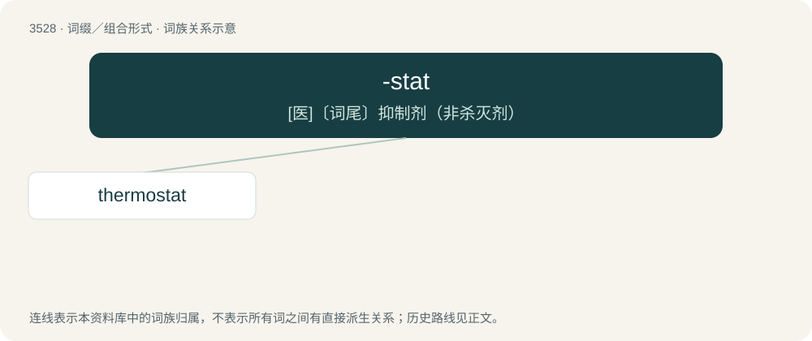

# 3604 · -stat — \[医\]〔词尾〕抑制剂（非杀灭剂）

[总目录](../00_总目录_按常用程度.md)

**类型**：词缀／组合形式　｜　**来源语言**：见词源记录

## 核心含义与来源

- 核心含义：\[医\]〔词尾〕抑制剂（非杀灭剂）
- 英文含义：Used to form nouns naming scientific instruments that act to render the prefixed element stationary or static in some respect.
- 词形：-stat

**来源记录 1**（后缀／后置成分；Used to form nouns naming scientific instruments that act to render the prefixed element stationary or static in some respect.）

The terminal element in certain names of scientific instruments, employed on the analogy of early coinages from other languages, namely heliostat (from the New Latin hēliostata, itself apparently representing an assumed Ancient Greek etymon of the form \*ἡλιοστάτης (hēliostátēs), from ἥλιος (hḗlios, “sun”) + -στάτης (-státēs), the latter an agent-nominal suffix from the aorist active participial stem (the στα- (sta-) root) of ἵστημι (hístēmi, “to cause to stand”, “to set”)), siderostat (from the Latin sīdus, star + the Ancient Greek -στάτης (-státēs)), and aerostat (from the French aérostat, itself a back-formation from aérostatique (formed after hydrostatique), formed on the analogy of héliostat); later coinages have been formed on the analogy of heliostat, apparently with some reference to the Ancient Greek στατός (statós, “standing”, “stationary”). See also clinostat, hydrostat, and thermostat.

## 词族图

## 单词速览（常用到不常用）

| 单词 | 音标 | 释义 |
|---|---|---|
| [thermostat](#w-1) | 美 /ˈθɝməstæt/ | n. 自动调温器, 温度自动启闭装置；\[化\] 恒温器; 恒温箱 |

## 逐词详解

### 1. thermostat

**词性**：名词　｜　**音标**：美 /ˈθɝməstæt/

**中文释义**：n. 自动调温器, 温度自动启闭装置；\[化\] 恒温器; 恒温箱

**英文义项**：A device that automatically responds to changes in temperature by activating a heating or cooling system to maintain the temperature at a desired setting. / An algorithm used to maintain a simulated system at a set temperature by absorbing or releasing heat

**构词拆分**：thermo- + -stat

**词源与演化**：

From thermo- + -stat.

**例句**：

> You don't need to turn up your thermostat when it's cold outside.
