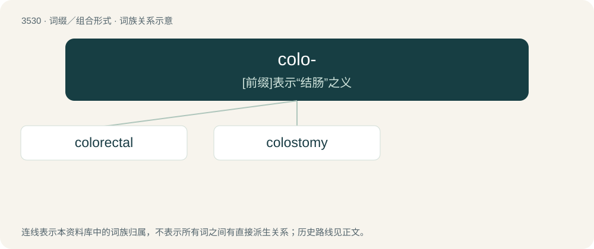

# 3605 · colo- — \[前缀\]表示“结肠”之义

[总目录](../00_总目录_按常用程度.md)

**类型**：词缀／组合形式　｜　**来源语言**：见词源记录

## 核心含义与来源

- 核心含义：\[前缀\]表示“结肠”之义
- 英文含义：Pertaining to the colon.
- 词形：colo-

**来源记录 1**（前缀／前置成分；Pertaining to the colon.）

From international scientific vocabulary, reflecting a New Latin combining form, from Latin colon, whence also English colon.

## 词族图

## 单词速览（常用到不常用）

| 单词 | 音标 | 释义 |
|---|---|---|
| [colorectal](#w-1) | /,kəjləˈrektəl/ | a. \[解\]结肠直肠的 |
| [colostomy](#w-2) | /kəˈlɔstəmi/ | n. 结肠开口术；\[医\] 结肠造口术 |

## 逐词详解

### 1. colorectal

**词性**：形容词　｜　**音标**：/,kəjləˈrektəl/

**中文释义**：a. \[解\]结肠直肠的

**英文义项**：Of or pertaining to the colorectum.

**构词拆分**：colo- + rectal

**词源与演化**：

From colo- + rectal.

**例句**：

> Inflammatory bowel diseases, such as Crohn’s disease and ulcerative colitis, are extremely painful and can lead to colorectal cancer.

### 2. colostomy

**词性**：名词　｜　**音标**：/kəˈlɔstəmi/

**中文释义**：n. 结肠开口术；\[医\] 结肠造口术

**英文义项**：An incision into the colon to allow for drainage. / The opening produced in such incision.

**构词拆分**：colo- + -stomy

**词源与演化**：

From colo- + -stomy.
