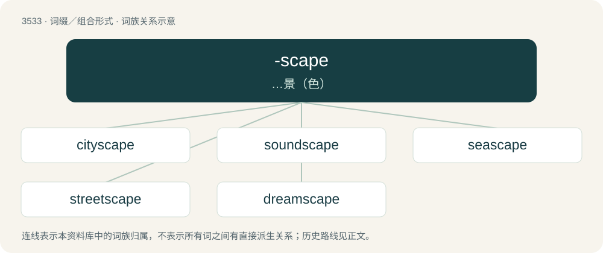

# 3607 · -scape — …景（色）

[总目录](../00_总目录_按常用程度.md)

**类型**：词缀／组合形式　｜　**来源语言**：见词源记录

## 核心含义与来源

- 核心含义：…景（色）
- 英文含义：form, formation, shape
- 词形：-scape

**来源记录 1**（后缀／后置成分；form, formation, shape）

Back-formation from landscape, the suffix representing Middle Dutch -schap (“the English suffix -ship, e.g. of friendship, kinship, ownership”), from Old Dutch -skap (“-ship”), from Proto-Germanic \*-skapiz (“-ship”), from \*skapaz (“shape, form”). Cognate with Modern Dutch -schap (“-ship”), German -schaft (“-ship”), Swedish -skap (“-ship”), -scipe (“-ship”). More at -ship, shape.

## 词族图

## 单词速览（常用到不常用）

| 单词 | 音标 | 释义 |
|---|---|---|
| [cityscape](#w-1) | /ˈsitiskeip/ | n. 都市风景 |
| [soundscape](#w-2) | /ˈsaʊndskeɪp/ | n. 音响范围 |
| [seascape](#w-3) | 美 /ˈsiˌskeɪp/ | n. 海景, 海景画 |
| [streetscape](#w-4) | 英 /ˈstɹitˌskeɪp/ | 街景画 |
| [dreamscape](#w-5) | /ˈdriːmskeip/ | 幻景 |

## 逐词详解

### 1. cityscape

**词性**：名词　｜　**音标**：/ˈsitiskeip/

**中文释义**：n. 都市风景

**英文义项**：The view of the buildings of a city, usually referring to a pictured landscape.

**构词拆分**：city + -scape

**词源与演化**：

From city + -scape.

**例句**：

> The dominant character of the cityscape is it poverty.

该用例对应义项：a viewpoint toward a city or other heavily populated area

### 2. soundscape

**词性**：名词　｜　**音标**：/ˈsaʊndskeɪp/

**中文释义**：n. 音响范围

**英文义项**：An acoustic environment, a virtual/emotional environment created using sound. / An electroacoustic musical composition creating a sound portrait of a sound environment.

**构词拆分**：sound + -scape

**词源与演化**：

From sound + -scape.

**例句**：

> The team of researchers recorded the springtime soundscape of northern Alaska for five sequential years.

### 3. seascape

**词性**：名词　｜　**音标**：美 /ˈsiˌskeɪp/

**中文释义**：n. 海景, 海景画

**英文义项**：A view of the sea. / A piece of art that depicts the sea or shoreline.

**构词拆分**：sea + -scape

**词源与演化**：

From sea + -scape.

### 4. streetscape

**词性**：名词　｜　**音标**：英 /ˈstɹitˌskeɪp/

**中文释义**：街景画

**英文义项**：The visual elements of a street, including the road, adjoining buildings, sidewalks, street furniture, trees and open spaces, etc, that combine to form the street's character.

**构词拆分**：street + -scape

**词源与演化**：

From street + -scape.

**例句**：

> From the first automobiles, it took 40 years until the horse had disappeared from the streetscape.

### 5. dreamscape

**词性**：名词　｜　**音标**：/ˈdriːmskeip/

**中文释义**：幻景

**英文义项**：The landscape within a dream.

**构词拆分**：dream + -scape

**词源与演化**：

From dream + -scape.
