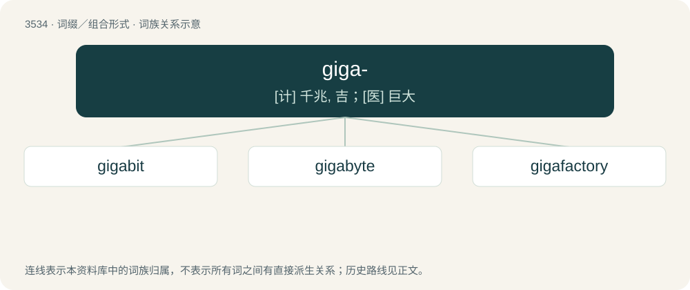

# 3608 · giga- — \[计\] 千兆, 吉；\[医\] 巨大

[总目录](../00_总目录_按常用程度.md)

**类型**：词缀／组合形式　｜　**来源语言**：见词源记录

## 核心含义与来源

- 核心含义：\[计\] 千兆, 吉；\[医\] 巨大
- 英文含义：In the International System of Units and other metric systems of units, multiplying the unit to which it is attached by 10⁹ (short scale billion or long scale milliard).
- 词形：giga-

**来源记录 1**（前缀／前置成分；In the International System of Units and other metric systems of units, multiplying the unit to which it is attached by 10⁹ (short scale billion or long scale milliard).）

From Ancient Greek γίγας (gígas, “giant”); cognate to giant.

## 词族图

## 单词速览（常用到不常用）

| 单词 | 音标 | 释义 |
|---|---|---|
| [gigabit](#w-1) | 英 /ˈɡɪɡəbɪt/；美 /ˈɡɪɡəbɪt/ | n. 千兆比特, 吉比特（10的9次方比特, 相当于十亿比特的信息单位） |
| [gigabyte](#w-2) | 英 /ˈɡɪɡəbaɪt/；美 /ˈɡɪɡəbaɪt/ | n. 吉字节；\[计\] 千兆字节 |
| [gigafactory](#w-3) |  | 【英文】A very large manufacturing facility. |

## 逐词详解

### 1. gigabit

**词性**：名词　｜　**音标**：英 /ˈɡɪɡəbɪt/；美 /ˈɡɪɡəbɪt/

**中文释义**：n. 千兆比特, 吉比特（10的9次方比特, 相当于十亿比特的信息单位）

**英文义项**：One billion (10⁹, or 1,000,000,000) bits or 1,000 megabits. / A gibibit.

**构词拆分**：giga- + bit

**词源与演化**：

From giga- + bit.

### 2. gigabyte

**词性**：名词　｜　**音标**：英 /ˈɡɪɡəbaɪt/；美 /ˈɡɪɡəbaɪt/

**中文释义**：n. 吉字节；\[计\] 千兆字节

**英文义项**：One billion (10⁹, or 1,000,000,000) bytes or 1,000 megabytes. / A gibibyte.

**构词拆分**：giga- + byte

**词源与演化**：

From giga- + byte.

**例句**：

> Five motherboards of new models have been brought to the market by Gigabyte Bangladesh authorities.

### 3. gigafactory

**词性**：名词

**英文义项**：A very large manufacturing facility. / A factory producing electric batteries at a large scale.

**构词拆分**：giga- + factory

**词源与演化**：

From giga- + factory; Coined by billionaire Elon Musk in 2013 for his Tesla Motors, and since used by others.
