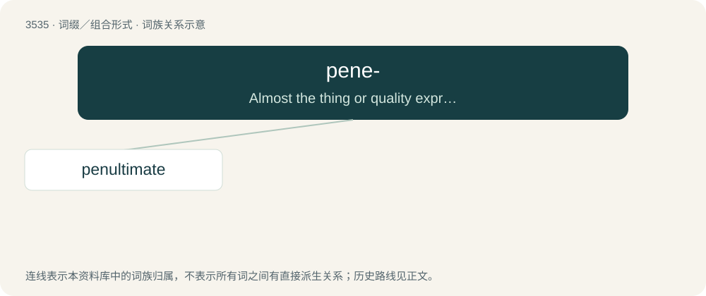

# 3609 · pene- — Almost the thing or quality expressed by the root, as peneplain (almost a plain), peninsula (almost an island), penultimate (almost the last), penumbra (almost in shadow).

[总目录](../00_总目录_按常用程度.md)

**类型**：词缀／组合形式　｜　**来源语言**：见词源记录

## 核心含义与来源

- 核心含义：Almost the thing or quality expressed by the root, as peneplain (almost a plain), peninsula (almost an island), penultimate (almost the last), penumbra (almost in shadow).
- 英文含义：Almost the thing or quality expressed by the root, as peneplain (almost a plain), peninsula (almost an island), penultimate (almost the last), penumbra (almost in shadow).
- 词形：pene-

**来源记录 1**（前缀／前置成分；Almost the thing or quality expressed by the root, as peneplain (almost a plain), peninsula (almost an island), penultimate (almost the last), penumbra (almost in shadow).）

From Latin paene (“almost”).

## 词族图

## 单词速览（常用到不常用）

| 单词 | 音标 | 释义 |
|---|---|---|
| [penultimate](#w-1) | /pɪˈnʌl.tɪ.mɪt/ | a. 倒数第二的 |

## 逐词详解

### 1. penultimate

**词性**：形容词　｜　**音标**：/pɪˈnʌl.tɪ.mɪt/

**中文释义**：a. 倒数第二的

**英文义项**：Next to last, second to last; immediately preceding the end of a sequence, list, etc. / Of or pertaining to a penult.

**构词拆分**：Latin paenultimus (“penultimate”) + -ate (adjective-forming suffix)；pene- + ultimate

**词源与演化**：

From Latin paenultimus (“penultimate”) + -ate (adjective-forming suffix), from paene (“almost”) + ultimus (“last”). Equivalent to pene- + ultimate. Compare French pénultième.

**例句**：

> The author inadvertently reveals the murderer in the penultimate chapter.

该用例对应义项：next to the last
