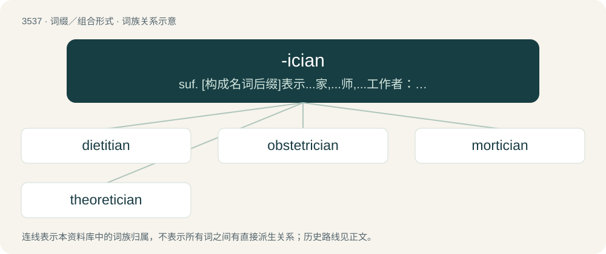

# 3611 · -ician — suf. \[构成名词后缀\]表示...家,...师,...工作者：beautician, geometrician, physician

[总目录](../00_总目录_按常用程度.md)

**类型**：词缀／组合形式　｜　**来源语言**：见词源记录

## 核心含义与来源

- 核心含义：suf. \[构成名词后缀\]表示...家,...师,...工作者：beautician, geometrician, physician
- 英文含义：forming nouns denoting occupations
- 词形：-ician

**来源记录 1**（后缀／后置成分；forming nouns denoting occupations）

From French -icien, from -ique f sg + -ien. By surface analysis, -ic + -ian.

## 词族图

## 单词速览（常用到不常用）

| 单词 | 音标 | 释义 |
|---|---|---|
| [dietitian](#w-1) | /daɪəˈtɪʃən/ | n. 饮食学家, 营养学家；\[医\] 饮食学家 |
| [obstetrician](#w-2) | 英 /ˌɒbstəˈtɹɪʃən/；美 /ˌɑbstəˈtɹɪʃən/ | n. 产科医师；\[医\] 产科医师 |
| [mortician](#w-3) | /mɔː(ɹ)ˈtɪʃən/ | n. 殡仪业者；\[医\] 殡仪业者 |
| [theoretician](#w-4) | 英 /ˌθɪə.rəˈtɪʃ.(ə)n/ | n. 理论家 |

## 逐词详解

### 1. dietitian

**词性**：名词　｜　**音标**：/daɪəˈtɪʃən/

**中文释义**：n. 饮食学家, 营养学家；\[医\] 饮食学家

**英文义项**：A person who studies or practices dietetics.

**构词拆分**：diet + -ician

**词源与演化**：

Irregular spelling of diet + -ician, probably influenced by dietetic.

**例句**：

> The dietitian told me that I eat too much starch.

### 2. obstetrician

**词性**：名词　｜　**音标**：英 /ˌɒbstəˈtɹɪʃən/；美 /ˌɑbstəˈtɹɪʃən/

**中文释义**：n. 产科医师；\[医\] 产科医师

**英文义项**：A physician who specializes in childbirth.

**构词拆分**：From obstetrics + -ician.

**词源与演化**：

From obstetrics + -ician.

**例句**：

> An obstetrician estimates the progress of childbirth by measuring the time between each contraction.

### 3. mortician

**词性**：名词　｜　**音标**：/mɔː(ɹ)ˈtɪʃən/

**中文释义**：n. 殡仪业者；\[医\] 殡仪业者

**英文义项**：An undertaker or funeral director; especially, one who is also the embalmer or cremator.

**词源与演化**：

From Latin mort- (“death”) + -ician.

### 4. theoretician

**词性**：名词　｜　**音标**：英 /ˌθɪə.rəˈtɪʃ.(ə)n/

**中文释义**：n. 理论家

**英文义项**：Someone who is expert in the theory of a particular science or art. / A theorist.

**构词拆分**：From theoretic + -ician.

**词源与演化**：

From theoretic + -ician.

**例句**：

> He wasn't a theoretician, she says, he was interested in the practical application of knowledge.
