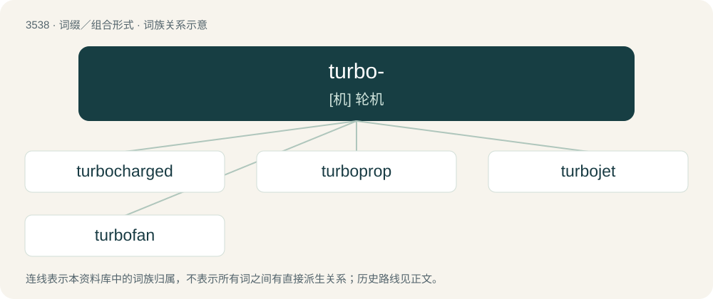

# 3612 · turbo- — \[机\] 轮机

[总目录](../00_总目录_按常用程度.md)

**类型**：词缀／组合形式　｜　**来源语言**：见词源记录

## 核心含义与来源

- 核心含义：\[机\] 轮机
- 英文含义：Turbine-related.
- 词形：turbo-

**来源记录 1**（前缀／前置成分；Turbine-related.）

Back-formation from turbine, and from Latin turbō, ~binis.

## 词族图

## 单词速览（常用到不常用）

| 单词 | 音标 | 释义 |
|---|---|---|
| [turbocharged](#w-1) | /ˈtɜːbə(ʊ)tʃɑːdʒ/ | vt. 用涡轮给增压 |
| [turboprop](#w-2) | /ˈtəːbəuprɔp/ | n. 涡轮螺桨发动机, 涡轮螺桨飞机；\[机\] 轮机螺旋桨推进 |
| [turbojet](#w-3) | /ˈtəbəjdʒet/ | n. 涡轮喷气发动机, 涡轮喷气飞机；\[机\] 轮机喷射 |
| [turbofan](#w-4) | /ˈtəːbəu,fæn/ | \[机\] 轮机式鼓风机 |

## 逐词详解

### 1. turbocharged

**词性**：形容词　｜　**音标**：/ˈtɜːbə(ʊ)tʃɑːdʒ/

**中文释义**：vt. 用涡轮给增压

**英文义项**：Having a turbocharger.

**构词拆分**：turbo- + charged

**词源与演化**：

From turbo- + charged.

### 2. turboprop

**词性**：名词　｜　**音标**：/ˈtəːbəuprɔp/

**中文释义**：n. 涡轮螺桨发动机, 涡轮螺桨飞机；\[机\] 轮机螺旋桨推进

**英文义项**：A type of gas turbine aircraft engine that drives and obtains essentially all thrust from an external (typically unducted) propeller. / An aircraft that uses a turboprop engine.

**构词拆分**：turbo- + prop

**词源与演化**：

From turbo- + prop.

**例句**：

> A C-130 transport plane is a turboprop aircraft. Its main thrust comes from the propellers, but the propellers are turned by turbine engines.

### 3. turbojet

**词性**：名词　｜　**音标**：/ˈtəbəjdʒet/

**中文释义**：n. 涡轮喷气发动机, 涡轮喷气飞机；\[机\] 轮机喷射

**英文义项**：A jet engine that develops thrust solely from high-speed exhaust gases expelled from a turbine that drives a compressor.

**构词拆分**：turbo- + jet

**词源与演化**：

From turbo- + jet.

### 4. turbofan

**词性**：名词　｜　**音标**：/ˈtəːbəu,fæn/

**中文释义**：\[机\] 轮机式鼓风机

**英文义项**：A turbojet engine having a (usually ducted) fan that drives a stream of air that partly bypasses the turbojet portion; in high-bypass-ratio types, most of the thrust comes from the bypass portion rather than the turbojet portion, and this can be thought of in simplistic terms as that the turbojet portion drives the fan and the fan propels the aircraft. / An aircraft with such engines.

**构词拆分**：turbo- + fan

**词源与演化**：

From turbo- + fan.

**例句**：

> A turbofan engine is the most modern variation of the basic gas turbine engine.
