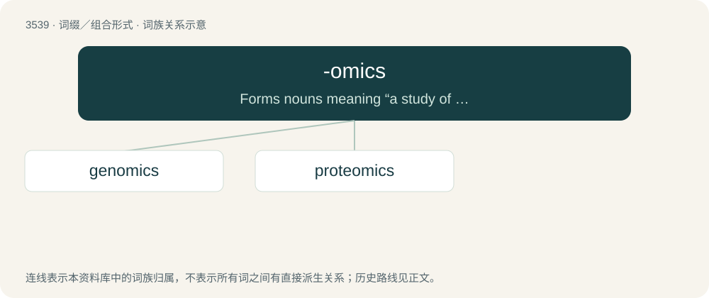

# 3613 · -omics — Forms nouns meaning “a study of the totality of something”.

[总目录](../00_总目录_按常用程度.md)

**类型**：词缀／组合形式　｜　**来源语言**：见词源记录

## 核心含义与来源

- 核心含义：Forms nouns meaning “a study of the totality of something”.
- 英文含义：Forms nouns meaning “a study of the totality of something”.
- 词形：-omics

**来源记录 1**（后缀／后置成分；Forms nouns meaning “a study of the totality of something”.）

From -ome (“whole of class”) + -ics, both via international scientific vocabulary and New Latin ultimately from Ancient Greek.

## 词族图

## 单词速览（常用到不常用）

| 单词 | 音标 | 释义 |
|---|---|---|
| [genomics](#w-1) | /dʒəˈnəʊmɪks/ | 基因组学 |
| [proteomics](#w-2) | 美 /ˌpɹoʊtiˈɑmɪks/ | 蛋白质组学 |

## 逐词详解

### 1. genomics

**词性**：名词　｜　**音标**：/dʒəˈnəʊmɪks/

**中文释义**：基因组学

**英文义项**：The study of the complete genome of an organism.

**构词拆分**：gene + -omics；genome + -ics

**词源与演化**：

From gene + -omics or genome + -ics.

**例句**：

> Recently, the American Museum of Natural History established the Institute for Comparative Genomics.

### 2. proteomics

**词性**：名词　｜　**音标**：美 /ˌpɹoʊtiˈɑmɪks/

**中文释义**：蛋白质组学

**英文义项**：The branch of molecular biology that studies the set of proteins expressed by the genome of an organism.

**构词拆分**：From protein + -omics.

**词源与演化**：

From protein + -omics.
