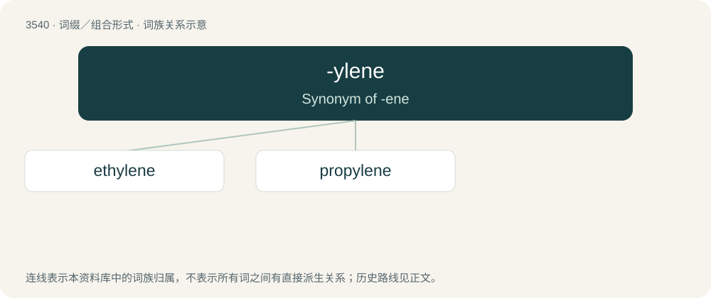

# 3614 · -ylene — Synonym of -ene

[总目录](../00_总目录_按常用程度.md)

**类型**：词缀／组合形式　｜　**来源语言**：见词源记录

## 核心含义与来源

- 核心含义：Synonym of -ene
- 英文含义：Synonym of -ene
- 词形：-ylene

**来源记录 1**（后缀／后置成分；Synonym of -ene）

From ethylene and amylene, where the -yl- is etymological. Sense 2 from -yl + -ene.

## 词族图

## 单词速览（常用到不常用）

| 单词 | 音标 | 释义 |
|---|---|---|
| [ethylene](#w-1) | /ˈɛθɪˌliːn/ | n. 乙烯；\[化\] 乙烯; 1,2-亚乙基 |
| [propylene](#w-2) | /ˈprəupiliːn/ | n. 丙二醇；\[化\] 丙烯 |

## 逐词详解

### 1. ethylene

**词性**：名词　｜　**音标**：/ˈɛθɪˌliːn/

**中文释义**：n. 乙烯；\[化\] 乙烯; 1,2-亚乙基

**英文义项**：The common name for the organic chemical compound ethene. The simplest alkene, a colorless gaseous (at room temperature and pressure) hydrocarbon with the chemical formula C₂H₄. / The divalent radical derived from ethane.

**构词拆分**：eth- + -ylene

**词源与演化**：

From eth- + -ylene.

**例句**：

> Some vegetables are easily affected by ethylene, including asparagus, broccoli, cabbage and cucumbers.

### 2. propylene

**词性**：名词　｜　**音标**：/ˈprəupiliːn/

**中文释义**：n. 丙二醇；\[化\] 丙烯

**英文义项**：The organic chemical compound propene. An alkene which is a colorless gaseous (at room temperature and pressure) hydrocarbon with the chemical formula C₃H₆.

**词源与演化**：

Coined by John Williams Reynolds in 1851, from French propionique + -ylene
