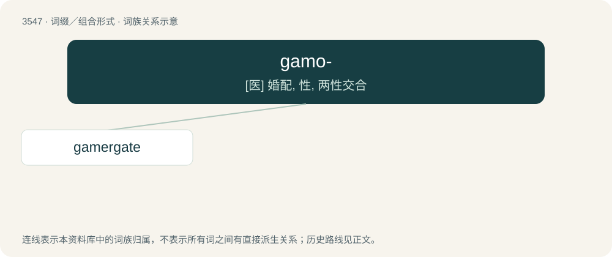

# 3620 · gamo- — \[医\] 婚配, 性, 两性交合

[总目录](../00_总目录_按常用程度.md)

**类型**：词缀／组合形式　｜　**来源语言**：见词源记录

## 核心含义与来源

- 核心含义：\[医\] 婚配, 性, 两性交合
- 英文含义：marriage
- 词形：gamo-

**来源记录 1**（前缀／前置成分；marriage）

Combining form of Ancient Greek γάμος (gámos).

## 词族图

## 单词速览（常用到不常用）

| 单词 | 音标 | 释义 |
|---|---|---|
| [gamergate](#w-1) | 英 /ˈɡæm.ə.ɡeɪt/；美 /ˈɡæm.əɹˌɡeɪt/ | 【英文】A worker insect that can become capable of reproducing when the queen has died. |

## 逐词详解

### 1. gamergate

**词性**：名词　｜　**音标**：英 /ˈɡæm.ə.ɡeɪt/；美 /ˈɡæm.əɹˌɡeɪt/

**英文义项**：A worker insect that can become capable of reproducing when the queen has died.

**构词拆分**：gam- + ergate

**词源与演化**：

From gam- + ergate, from Ancient Greek γάμος (gámos, “union, marriage”) + Ancient Greek ἐργάτης (ergátēs, “workman”).

**例句**：

> GamerGate and its descendants were and are everything that reactionaries claim "cancel culture" is.
