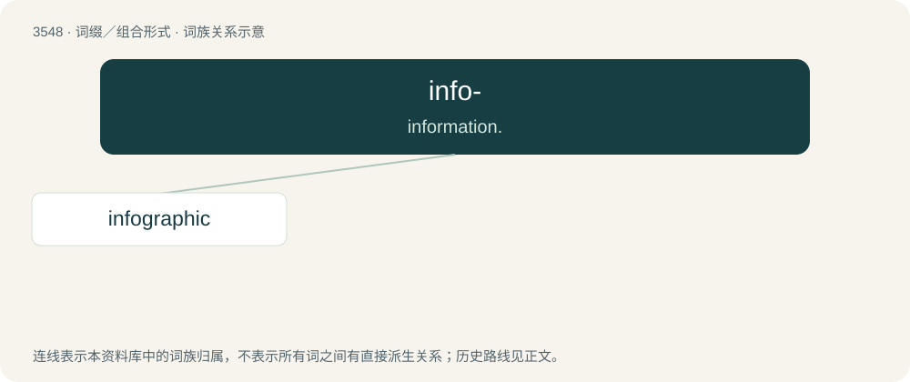

# 3621 · info- — information.

[总目录](../00_总目录_按常用程度.md)

**类型**：词缀／组合形式　｜　**来源语言**：见词源记录

## 核心含义与来源

- 核心含义：information.
- 英文含义：information.
- 词形：info-

**来源记录 1**（前缀／前置成分；information.）

From information.

## 词族图

## 单词速览（常用到不常用）

| 单词 | 音标 | 释义 |
|---|---|---|
| [infographic](#w-1) |  | 【英文】A visual representation of information. |

## 逐词详解

### 1. infographic

**词性**：名词

**英文义项**：A visual representation of information.

**构词拆分**：info- + graphic

**词源与演化**：

From info- + graphic.
