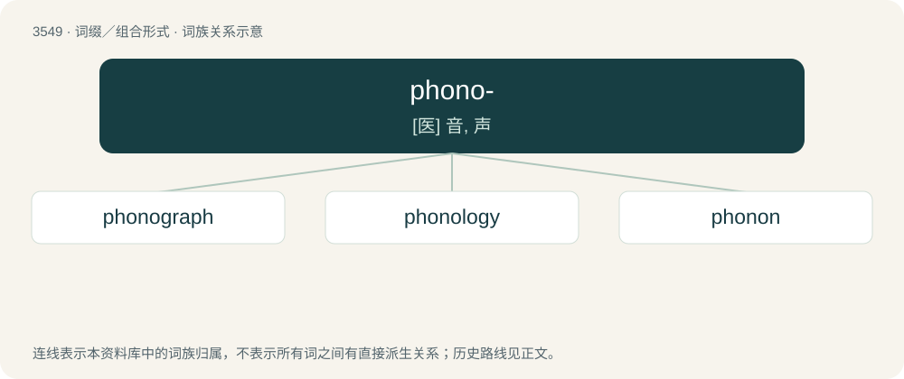

# 3624 · phono- — \[医\] 音, 声

[总目录](../00_总目录_按常用程度.md)

**类型**：词缀／组合形式　｜　**来源语言**：见词源记录

## 核心含义与来源

- 核心含义：\[医\] 音, 声
- 英文含义：Relating to sound
- 词形：phono-

**来源记录 1**（前缀／前置成分；Relating to sound）

From Ancient Greek φωνή (phōnḗ, “voice, sound”). The word φωνή primarily referred to articulated human or animal sounds. This is in contrast to ἠχή -- from which echo is derived -- which referred to sounds in general.

## 词族图

## 单词速览（常用到不常用）

| 单词 | 音标 | 释义 |
|---|---|---|
| [phonograph](#w-1) | 英 /ˈfəʊnəˌɡɹɑːf/；美 /ˈfoʊnəˌɡɹæf/ | n. 留声机, 电唱机；vi. 用留声机灌音, 用留声机放音 |
| [phonology](#w-2) | 英 /fəˈnɒləd͡ʒi/；美 /fəˈnɑləd͡ʒi/ | n. 音系学, 历时音系学；\[医\] 语音学 |
| [phonon](#w-3) | 美 /ˈfoʊ.nɑn/ | n. 声子；\[计\] 声子 |

## 逐词详解

### 1. phonograph

**词性**：名词　｜　**音标**：英 /ˈfəʊnəˌɡɹɑːf/；美 /ˈfoʊnəˌɡɹæf/

**中文释义**：n. 留声机, 电唱机；vi. 用留声机灌音, 用留声机放音

**英文义项**：A device that captures sound waves onto an engraved archive; a lathe. / A device that records or plays sound from cylinder records.

**构词拆分**：phono- + -graph

**词源与演化**：

From phono- + -graph.

**例句**：

> I have to change the sapphire of my phonograph.

### 2. phonology

**词性**：名词　｜　**音标**：英 /fəˈnɒləd͡ʒi/；美 /fəˈnɑləd͡ʒi/

**中文释义**：n. 音系学, 历时音系学；\[医\] 语音学

**英文义项**：The study of the way sounds function in languages, including accent, intonation, phonemes, stress, and syllable structure, and which sounds are distinctive units within a language; (countable) the way sounds function within a given language; a phonological system. / The study of the way components of signs function in a sign language, and which components are distinctive units within the language; (countable) the way components of signs function within a given sign language.

**构词拆分**：phono- (prefix denoting sound) + -logy (suffix denoting a branch of learning, or a study of a particular subject)

**词源与演化**：

From phono- (prefix denoting sound) + -logy (suffix denoting a branch of learning, or a study of a particular subject).

**例句**：

> As for phonology, Tagalog has more clarity and rhythm than does English.

### 3. phonon

**词性**：名词　｜　**音标**：美 /ˈfoʊ.nɑn/

**中文释义**：n. 声子；\[计\] 声子

**英文义项**：The quantum of acoustic or vibrational energy (sound), considered a discrete particle rather than a wave.

**构词拆分**：phono- + -on

**词源与演化**：

From phono- + -on. From Ancient Greek φωνή (phōnḗ, “sound”). Modelled after photon.
