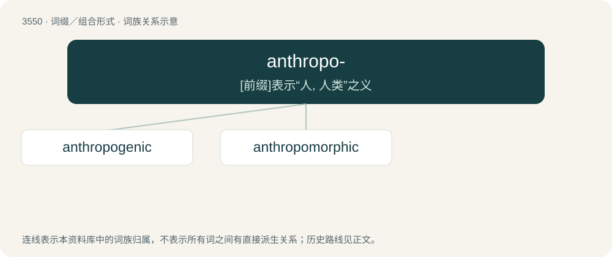

# 3625 · anthropo- — \[前缀\]表示“人, 人类”之义

[总目录](../00_总目录_按常用程度.md)

**类型**：词缀／组合形式　｜　**来源语言**：见词源记录

## 核心含义与来源

- 核心含义：\[前缀\]表示“人, 人类”之义
- 英文含义：Forming words related to men or people.
- 词形：anthropo-

**来源记录 1**（前缀／前置成分；Forming words related to men or people.）

Combining form of Ancient Greek ἄνθρωπος (ánthrōpos, “man, human”).

## 词族图

## 单词速览（常用到不常用）

| 单词 | 音标 | 释义 |
|---|---|---|
| [anthropogenic](#w-1) | /ˌæn θrə pəˈdʒɛn ɪk/ | \[医\] 人类发生的, 人类起源的 |
| [anthropomorphic](#w-2) | 英 /ˌænθɹəʊpəʊˈmɔːfɪk/；美 /ˌænθɹəpəˈmɔɹfɪk/ | a. 被赋于人形的；\[医\] 有人形的, 类人的 |

## 逐词详解

### 1. anthropogenic

**词性**：形容词　｜　**音标**：/ˌæn θrə pəˈdʒɛn ɪk/

**中文释义**：\[医\] 人类发生的, 人类起源的

**英文义项**：Pertaining to the origin of man (anthropogeny). / Having its origin in the influence of human activity on nature.

**构词拆分**：anthropo- + -genic

**词源与演化**：

From anthropo- + -genic. First use appears c. 1883.

**例句**：

> Wastewater is any water that has been adversely affected in quality by anthropogenic influence.

该用例对应义项：Having its origin in the influence of human activity on nature.

### 2. anthropomorphic

**词性**：形容词　｜　**音标**：英 /ˌænθɹəʊpəʊˈmɔːfɪk/；美 /ˌænθɹəpəˈmɔɹfɪk/

**中文释义**：a. 被赋于人形的；\[医\] 有人形的, 类人的

**英文义项**：Having the form of a human. / Having attributes or characteristics of a human being.

**构词拆分**：anthropo- + -morphic

**词源与演化**：

From anthropo- + -morphic.

**例句**：

> Like you, she thinks about languages in an anthropomorphic and anthropocentric way.
