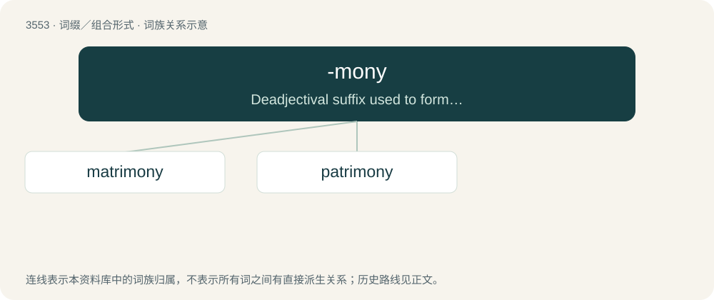

# 3627 · -mony — Deadjectival suffix used to form an abstract noun usually from personal adjectives.

[总目录](../00_总目录_按常用程度.md)

**类型**：词缀／组合形式　｜　**来源语言**：见词源记录

## 核心含义与来源

- 核心含义：Deadjectival suffix used to form an abstract noun usually from personal adjectives.
- 英文含义：Deadjectival suffix used to form an abstract noun usually from personal adjectives.
- 词形：-mony

**来源记录 1**（后缀／后置成分；Deadjectival suffix used to form an abstract noun usually from personal adjectives.）

Learned borrowing from Latin -mōnium, -mōnia.

## 词族图

## 单词速览（常用到不常用）

| 单词 | 音标 | 释义 |
|---|---|---|
| [matrimony](#w-1) | 英 /ˈmat.ɹɪ.mə.ni/；美 /ˈmæt.ɹɪˌmoʊ.ni/ | n. 结婚, 婚姻生活, 婚礼；\[法\] 婚姻, 结婚, 婚礼 |
| [patrimony](#w-2) | 英 /ˈpat.ɹɪ.mə.ni/；美 /ˈpæt.ɹɪˌmoʊ.ni/ | n. 祖传的财物, 继承物；\[经\] 世袭财产, 遗产 |

## 逐词详解

### 1. matrimony

**词性**：名词　｜　**音标**：英 /ˈmat.ɹɪ.mə.ni/；美 /ˈmæt.ɹɪˌmoʊ.ni/

**中文释义**：n. 结婚, 婚姻生活, 婚礼；\[法\] 婚姻, 结婚, 婚礼

**英文义项**：Marriage; the state of being married. / The ceremony of marriage.

**构词拆分**：By surface analysis, matri- + -mony

**词源与演化**：

From Old French matremoine, from Latin mātrimōnium (“marriage, wedlock”), from mātri(s) (“mother”) + -mōnium (“obligation”). By surface analysis, matri- + -mony. Compare patrimony.

**例句**：

> Matrimony is the attempt of a couple to solve problems they would never have had as singles.

### 2. patrimony

**词性**：名词　｜　**音标**：英 /ˈpat.ɹɪ.mə.ni/；美 /ˈpæt.ɹɪˌmoʊ.ni/

**中文释义**：n. 祖传的财物, 继承物；\[经\] 世袭财产, 遗产

**英文义项**：A right or estate inherited from one's father; or, in a larger sense, from any male ancestor. / Formerly, a church estate or endowment.

**构词拆分**：By surface analysis, patri- + -mony

**词源与演化**：

From earlier patrimoyne, from patremoyne, from Middle French patrimoine/patremoine, semilearned borrowing from Latin patrimōnium, from pater (“father”) + -mōnium (“state, condition”). First attested in 1513. By surface analysis, patri- + -mony. Compare matrimony. Displaced native Old English fæderġestrēon.

**例句**：

> Men will sooner forget the death of their father than the loss of their patrimony.
