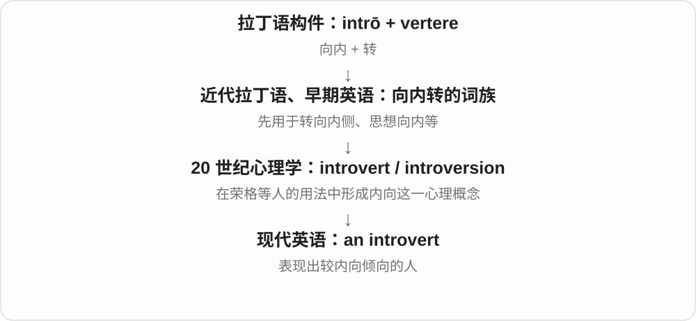
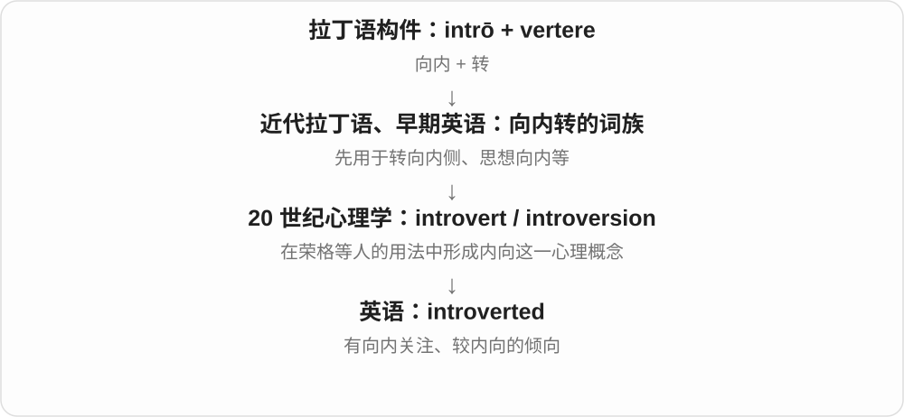
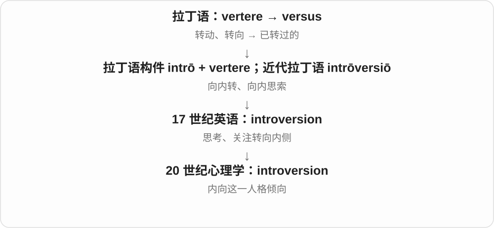

# 3628 · intro- — 向内、在里面

[逐词精讲目录](../00_逐词精讲目录.md) · [总目录](../00_总目录_按常用程度.md)

## 核心词根与来源

来自拉丁 intro 向内、里面，作为前部进入近代学术命名。心理学里的词义经历了专门定义和日常概括。

**INTRO-：把方向从外部转向内部**

introversion 在心理学词族里说内向；introvert 是相应人物名或动词形式，introverted 形容性格内向。

- **内向者及相关性质、倾向**：introvert · introverted · introversion

## 词形与演化规律

intro- 向内 + vert- 转 → introvert；对应名词 introversion，形容词 introverted。ver-/vert- 在拉丁相关词干中有不同形式。

## 单词速览（按词族由简到繁）

同一基础词的相关扩展放在一起，先读基础形式，再读扩展；各组之间优先读常用的。具体词源关系见各词讲解。

| 单词 | 音标 | 核心意思 |
|---|---|---|
| [introvert](#w-2) | 英 /ˈɪntrəvɜːt/；美 /ˈɪntrəvɜːrt/ | 内向的人 |
| [introverted](#w-3) | 英 /ˈɪntrəvɜːtɪd/；美 /ˈɪntrəvɜːrtɪd/ | 内向的；较关注内心世界的 |
| [introversion](#w-1) | 英 /ˌɪntrəˈvɜːʃən/；美 /ˌɪntrəˈvɜːrʒən/ | 内向倾向；内向性 |

## 逐词讲解

### 1. introvert — 内向的人

**音标**：英 /ˈɪntrəvɜːt/；美 /ˈɪntrəvɜːrt/

**先抓住这个画面**

注意力比较容易转向自己的思考、感受和内在体验。日常也常说这种人偏爱较安静的交流环境。

**怎么拆**

intrō“向内” + vertere“转”。英语更早有“向内转”的动词及生物学用法；现代人格名词与荣格的德语心理学术语传播有关。

**怎么变成今天的意思**

内向与外向可以看作连续的倾向，不必把每个人钉进两个格子。introvert 不等于害羞、讨厌人，也不等于不擅长演讲。

**常见搭配与例句**

an introvert；describe oneself as an introvert；introverts and extroverts。

> She is an introvert who enjoys long conversations with close friends.

她比较内向，却很喜欢和好友长谈。

> Being an introvert has not stopped him from becoming a confident speaker.

性格内向并没有妨碍他成为自信的演讲者。

**别混淆**

shy 侧重在别人面前不自在；introverted 侧重心理和行为倾向，两者可以重合也可以分开。

### 2. introverted — 内向的；较关注内心世界的

**音标**：英 /ˈɪntrəvɜːtɪd/；美 /ˈɪntrəvɜːrtɪd/

**先抓住这个画面**

把 introvert 这个“人”的标签，换成对一个人的倾向或表现的描述。

**怎么拆**

introvert + -ed；早先词族有向内转的动作义，现代人格形容词随心理学用法普及。

**怎么变成今天的意思**

可以说 quite introverted 或 more introverted，表达程度差异。安静一天不代表性格固定，更不能据此判断人的能力。

**常见搭配与例句**

an introverted child；rather introverted；more introverted than…。

> He is introverted in large groups but talkative with his sister.

他在人多时比较内向，和姐姐在一起却很健谈。

> The class includes both outgoing and introverted students.

班上既有外向的学生，也有内向的学生。

**别混淆**

introverted 不是 withdrawn 的必然同义词；withdrawn 往往强调退缩、不愿接触的状态。

### 3. introversion — 内向倾向；内向性

**音标**：英 /ˌɪntrəˈvɜːʃən/；美 /ˌɪntrəˈvɜːrʒən/

**先抓住这个画面**

不是数有几个“内向的人”，而是讨论注意力更向内、偏爱怎样的活动这种倾向本身。

**怎么拆**

来自近代拉丁语 intrōversiō“向内转”，英语早有思想向内的用法；心理学意义后来形成，不是现代名词 introvert 才造出它。

**怎么变成今天的意思**

通常不可数。现代研究常把它放在内向—外向连续范围内讨论，而不是把所有安静的人看成一种固定类型。

**常见搭配与例句**

introversion and extraversion；a tendency toward introversion。

> The questionnaire measures introversion as a matter of degree.

这份问卷把内向性作为一个有程度差别的特征来测量。

> Her introversion is compatible with a busy social life.

她的内向性并不妨碍她拥有丰富的社交生活。

**别混淆**

introversion 是倾向；introspection 是反省、观察自己内心的活动，外向的人也会反省。

## 这一组要分清什么

introversion 不是害羞的简单同义词：内向者也能自在社交，日常常侧重更偏好安静、独处和较少刺激的环境。

## 串起来练习

She is introverted but enjoys talking with close friends.

她性格内向，但喜欢和亲近的朋友聊天。
